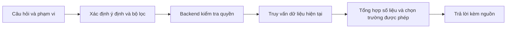

# Chatbot trợ lý công việc cho TaskFlow

Ngày lập: 27/09/2026.

Trạng thái: **Kế hoạch đã thống nhất, chưa triển khai code.** Tài liệu này mô tả bản đầu và các hướng mở rộng; các hướng mở rộng không thuộc phạm vi triển khai bản đầu.

## 1. Hướng triển khai đã chốt

Xây chatbot tiếng Việt giúp người dùng **tra cứu công việc, theo dõi tiến độ và nhận đề xuất dựa trên dữ liệu họ được phép xem**.

- Bản đầu chỉ tra cứu, tổng hợp và đề xuất; không tạo, sửa, xóa hoặc phân công công việc qua chat.
- Trưởng nhóm tương ứng với **OWNER/ADMIN của workspace**.
- Trưởng nhóm được xem thêm email và hồ sơ làm việc của thành viên thuộc workspace mình quản lý.
- Giữ quyền đọc bảng PRIVATE hiện tại: quản lý workspace không mặc nhiên được đọc bảng riêng nếu chưa có quyền xem bảng đó.
- Chính sách giới hạn thông tin mới áp dụng **trong chatbot trước**; API và giao diện hiện có vẫn theo chính sách cũ.

## 2. Chức năng và ranh giới dữ liệu

### 2.1. Chức năng bản đầu

| Nhóm chức năng | Ví dụ câu hỏi | Hành vi |
| --- | --- | --- |
| Việc cá nhân | “Việc nào của tôi sắp đến hạn?” | Liệt kê việc, hạn chót, trạng thái và liên kết mở thẻ. |
| Ưu tiên công việc | “Hôm nay tôi nên xử lý gì trước?” | Đề xuất từ việc quá hạn, hạn gần nhất và việc bị chặn; giải thích căn cứ. |
| Phối hợp trong nhóm | “Lan đang làm gì, đã xong những việc nào?” | Tổng hợp công việc của Lan trong phạm vi người hỏi được xem. |
| Tiến độ nhóm | “Tuần này nhóm hoàn thành gì, còn vướng gì?” | Tổng hợp việc hoàn thành, quá hạn, bị chặn và chưa giao người phụ trách. |
| Hỗ trợ trưởng nhóm | “Ai đang có nhiều việc?”, “Email của Lan là gì?” | Trả hồ sơ được phép xem và thống kê trong workspace đang quản lý. |

### 2.2. Phân quyền cụ thể

- **Thông tin của chính mình:** người dùng được hỏi công việc, email và hồ sơ làm việc của bản thân.
- **Thông tin đồng nghiệp dành cho thành viên:** tên, người được phân công, hạn chót, trạng thái và tiến độ công việc được phép xem. Không cung cấp email, giới hạn tải công việc, trạng thái tạm nghỉ hay điểm đánh giá cá nhân qua chức năng truy vấn hồ sơ.
- **Thông tin dành cho trưởng nhóm:** thêm email, vai trò workspace, `maxParallelCards`, `pausedUntil` và thống kê công việc trong phạm vi được xem.
- Quyền OWNER/ADMIN của một bảng không tự cấp quyền xem hồ sơ quản lý của cả workspace.
- Quyền của workspace A không được dùng để truy vấn hồ sơ trong workspace B.
- Thành viên có quyền VIEWER trên bảng chỉ được tra cứu thông tin công việc thuộc phạm vi đọc của họ; quyền này không mở hồ sơ quản lý.
- Mọi vai trò đều bị giới hạn bởi quyền đọc bảng. Thống kê phải ghi rõ phạm vi, không khẳng định đó là toàn bộ công việc của một người.
- Không đưa trường bảo mật tài khoản, token đăng nhập, token mời hoặc khóa API vào dữ liệu chatbot.

Chỉ tìm trong bảng người dùng sở hữu/tham gia và các bảng được phép xem thuộc workspace họ tham gia. Không tự tìm mọi bảng PUBLIC trên hệ thống.

## 3. Thiết kế bản đầu

### 3.1. Luồng xử lý

- Tạo module chatbot riêng. Tận dụng cơ chế gọi AI, timeout và xử lý lỗi hiện có; giữ riêng schema chatbot với schema sinh kế hoạch bảng.
- Model đề xuất các truy vấn thuộc danh sách cho phép: tìm việc, xem tiến độ, tổng hợp thống kê, xem hồ sơ bản thân và xem hồ sơ thành viên dành cho quản lý.
- Backend lấy danh tính từ phiên đăng nhập, kiểm tra phạm vi và chọn trường dữ liệu trước khi gửi kết quả cho model. Không cho model thực thi SQL tự do.
- Kiểm tra lại quyền mỗi lượt hỏi. Nội dung công việc được xem là dữ liệu, không được dùng để thay đổi quyền hoặc chỉ dẫn hệ thống. Cách này phù hợp với hướng dẫn [phân quyền của OWASP](https://cheatsheetseries.owasp.org/cheatsheets/Authorization_Cheat_Sheet.html) và [phòng chống prompt injection](https://cheatsheetseries.owasp.org/cheatsheets/LLM_Prompt_Injection_Prevention_Cheat_Sheet.html).
- Viết truy vấn và dữ liệu trả về riêng cho chatbot. Không chuyển nguyên kết quả từ API overview, danh sách thành viên hay module phân công vào model vì phạm vi và trường dữ liệu hiện tại khác chính sách đã chốt.
- Số lượng, khoảng ngày và tỷ lệ được tính ở backend trên toàn bộ tập kết quả hợp lệ. Danh sách hiển thị có phân trang; không đếm từ phần danh sách đã bị giới hạn.

### 3.2. API và giao diện

- Thêm `POST /api/chat/messages`, nhận câu hỏi, phạm vi đang chọn và mã hội thoại nếu có. Client không được truyền vai trò hoặc danh tính người thực hiện.
- Kết quả gồm câu trả lời, dữ liệu công việc, liên kết nguồn, phạm vi, thời điểm truy vấn và trạng thái cần làm rõ nếu có.
- Đặt nút **Trợ lý** trên Header, mở panel chat dùng được tại trang tổng quan và trang bảng.
- Hiển thị rõ phạm vi: **Việc của tôi / Workspace / Bảng**. Khi mở từ bảng hoặc workspace, mặc định dùng ngữ cảnh đó; ở trang chung mặc định là việc cá nhân.
- Liên kết nguồn mở trực tiếp thẻ bằng đường dẫn sẵn có: `/boards/:boardId?card=:cardId`.
- Hiển thị trạng thái đang xử lý, kết quả rỗng, lỗi và yêu cầu làm rõ bằng tiếng Việt. Câu trả lời phải phân biệt số liệu đã ghi nhận với đề xuất của trợ lý.

### 3.3. Mặc định nghiệp vụ

- Múi giờ: `Asia/Ho_Chi_Minh`. “Sắp đến hạn” là 7 ngày tới; “tuần này” từ thứ Hai đến hết Chủ nhật.
- Việc sắp hạn/quá hạn loại việc đã hoàn thành. Bản đầu loại bảng, danh sách và thẻ đã xóa hoặc lưu trữ.
- Tiến độ thể hiện bằng trạng thái và số mục checklist hoàn thành; không tự quy đổi thành phần trăm chất lượng công việc.
- Tải công việc là số thẻ chưa hoàn thành được giao trong phạm vi đang xem. Chỉ trưởng nhóm được đối chiếu tải của đồng nghiệp với giới hạn hồ sơ; luôn ghi rõ nếu dữ liệu chỉ phản ánh một phần tải.
- Trùng tên thành viên hoặc chưa xác định được workspace thì hỏi lại trước khi truy vấn chi tiết.
- Hội thoại tạm giữ theo người dùng trên backend, hết hạn sau 30 phút không hoạt động; chỉ giữ ý định, bộ lọc và tham chiếu cần cho câu hỏi tiếp. Dữ liệu được đọc lại mỗi lượt, không dùng câu trả lời cũ làm nguồn.
- Chưa lưu lịch sử chat lâu dài, chưa cần thêm bảng dữ liệu hoặc vector database. Log vận hành chỉ ghi thông tin kỹ thuật cần thiết, tránh lưu nguyên câu hỏi và kết quả cá nhân.
- AI lỗi hoặc không hiểu câu hỏi thì thông báo rõ và dẫn đến bộ lọc công việc; không tạo câu trả lời suy đoán.

### 3.4. Lưu ý khi tận dụng mã hiện có

Các điểm dưới đây được ghi nhận khi khảo sát và cần kiểm tra lại tại thời điểm triển khai:

- Adapter AI hiện tại phục vụ sinh kế hoạch bảng, có schema và cấu trúc đầu vào riêng. Chỉ tách phần dùng chung cần thiết và kiểm thử hồi quy tính năng cũ.
- Search hiện có thể tìm bảng PUBLIC ngoài nhóm; cần ràng buộc phạm vi tham gia cho chatbot.
- Workspace overview hiện giới hạn danh sách thẻ và có email trong dữ liệu thành viên; cần truy vấn tổng số độc lập và bộ chọn trường riêng.
- Hồ sơ làm việc hiện gắn với từng người trong từng workspace. Quyền quản lý hồ sơ phải kiểm tra cả người hỏi và thành viên mục tiêu trong cùng workspace.
- Module phân công có thể sử dụng lịch sử rộng hơn quyền đọc của chatbot và ghi nhật ký gợi ý. Việc tích hợp module này được để sang giai đoạn mở rộng, sau khi kiểm soát đầu vào và bằng chứng theo quyền chatbot.

## 4. Kiểm thử và điều kiện nghiệm thu

### 4.1. Phân quyền và bảo vệ dữ liệu

- Cùng câu hỏi dưới tài khoản thành viên và trưởng nhóm trả đúng phạm vi và đúng trường dữ liệu.
- Thành viên không lấy được hồ sơ quản lý bằng cách tự xưng trưởng nhóm, đổi ID hoặc hỏi vòng qua thống kê.
- Trưởng nhóm không đọc được bảng PRIVATE chưa có quyền xem, hoặc hồ sơ ở workspace không quản lý.
- Board OWNER/ADMIN không được tự động xem hồ sơ quản lý của workspace.
- Người dùng đọc được hồ sơ của chính mình nhưng không được dùng luồng này để đọc hồ sơ người khác.
- Thu hồi quyền, đổi vai trò hoặc chuyển thẻ sang bảng riêng giữa hai lượt chat không làm dữ liệu cũ được dùng lại.
- Mã hội thoại của người khác không cho phép đọc hoặc tiếp tục hội thoại của họ; phiên hết hạn không giữ quyền hoặc dữ liệu cũ.
- Chỉ dẫn độc hại trong tên/mô tả công việc không mở rộng truy vấn hoặc quyền.
- Bảng PUBLIC ngoài phạm vi tham gia, tài nguyên đã xóa/lưu trữ và trường bảo mật không xuất hiện trong kết quả hoặc dữ liệu gửi model.

### 4.2. Độ chính xác và trải nghiệm

- Kiểm tra hạn chót quanh nửa đêm, tuần hiện tại, việc không có hạn, việc hoàn thành rồi mở lại và thành viên trùng tên.
- Hơn 200 công việc vẫn trả tổng số chính xác, có phân trang và nguồn mở được.
- Checklist được trình bày theo hiện trạng; không khẳng định thời điểm hoàn thành từng mục khi dữ liệu không có thời điểm đó.
- Kiểm tra AI timeout, sai định dạng, không hiểu câu hỏi và kết quả rỗng.
- Kiểm tra phạm vi mặc định khi mở chat từ trang chung, workspace và bảng; đổi phạm vi phải sử dụng đúng dữ liệu của phạm vi mới.
- Kiểm tra hồi quy hai module AI hiện có khi tách phần gọi model dùng chung.

### 4.3. Thứ tự triển khai và mở tính năng

1. Xây chính sách quyền, danh sách trường được phép và truy vấn riêng cho chatbot.
2. Xây nhận diện ý định, API và quản lý hội thoại tạm.
3. Nối panel Trợ lý, bộ chọn phạm vi và liên kết nguồn.
4. Chạy bộ câu hỏi nghiệm thu, kiểm thử phân quyền, số liệu và hồi quy.
5. Chỉ mở tính năng sau khi các ca phân quyền và số liệu đạt yêu cầu.

## 5. Các hướng phát triển tiếp theo

Ưu tiên sau khi bản đầu hoạt động ổn định:

1. **Bản tin ngày/tuần theo yêu cầu:** chuẩn bị nội dung họp từ việc hoàn thành, việc bị chặn và việc cần quyết định.
2. **Gợi ý phân công có giải thích:** kết nối module phân công hiện có sau khi giới hạn dữ liệu đầu vào và bằng chứng theo quyền chatbot.
3. **Giải thích thay đổi:** trả lời ai đổi hạn, đổi phân công hoặc trạng thái khi lịch sử có ghi nhận; nêu rõ khi lịch sử thiếu.
4. **Nhắc việc chủ động:** người dùng đăng ký nhận bản tin hoặc cảnh báo; kiểm tra quyền tại thời điểm gửi.
5. **Hỏi đáp tài liệu đính kèm:** bổ sung tìm kiếm nội dung tài liệu với quyền kế thừa từ thẻ và bảng.
6. **Thao tác qua hội thoại:** tạo việc, giao việc hoặc đổi hạn qua bước xem trước và xác nhận cụ thể; triển khai thành giai đoạn riêng.

Hướng tạo khác biệt nên ưu tiên là **câu trả lời có nguồn, hiểu đúng phạm vi nhóm và giải thích được đề xuất**.
