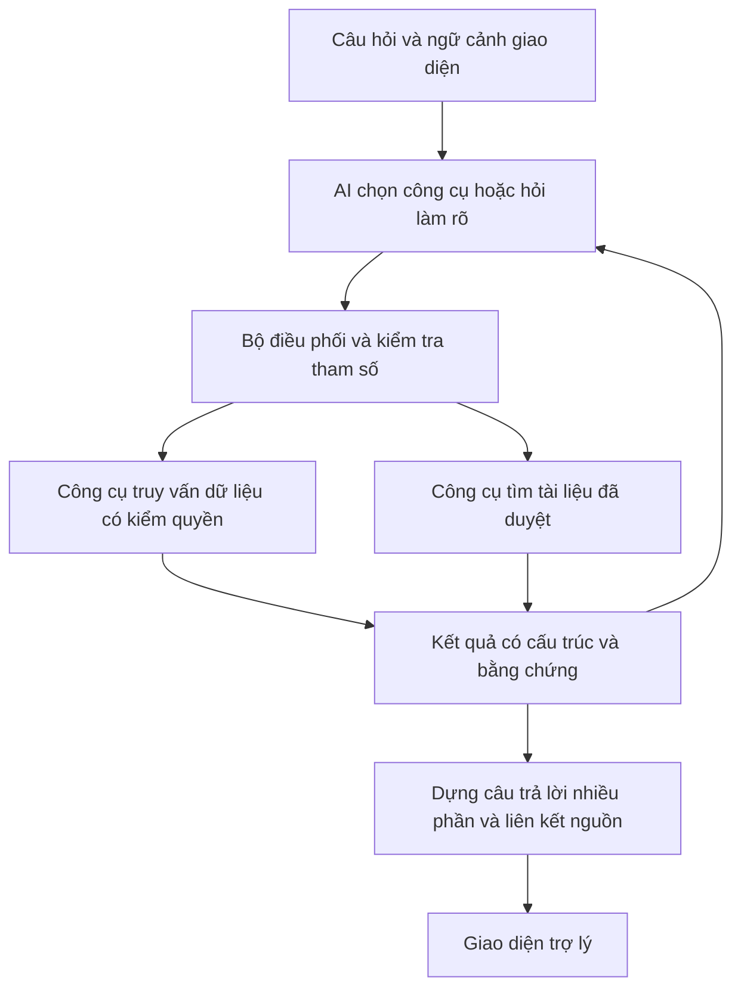

# Kế hoạch làm lại chatbot TaskFlow — phiên bản 2

Ngày lập: 04/10/2026.

Trạng thái: **Đã triển khai bước 1–6: công cụ dữ liệu, bộ điều phối Gemini, API/phiên v2 và panel nhiều phần.** Hợp đồng, cấu hình engine, cách dùng và giới hạn ở [CHATBOT_V2_MODULE.md](CHATBOT_V2_MODULE.md). Bước 7–9 (hướng dẫn/RAG, đánh giá diện rộng, mở rộng/rollout) còn lại. `CHATBOT_MODULE.md` giữ hợp đồng API v1; `CHATBOT_PLAN.md` là ý tưởng bản đầu.

## 1. Mục tiêu và phạm vi

Xây chatbot tiếng Việt có thể tìm thông tin, kết hợp nhiều truy vấn và giải thích kết quả trong phạm vi dữ liệu người dùng được xem. Khả năng trả lời được mở rộng bằng công cụ và tài liệu, thay vì mỗi câu hỏi mới cần một nhãn ý định và một mẫu câu trả lời riêng.

Hai câu hỏi bắt buộc dùng để nghiệm thu:

1. “Công việc nào đã được thay đổi?”
2. “Trong bảng 1234 ai đang có số lượng công việc lớn hơn và những công việc nào chưa được chia cho các thành viên?”

Phiên bản 2 trước mắt chỉ đọc dữ liệu và hướng dẫn sử dụng. Tạo, sửa, xóa, giao việc qua chat là một giai đoạn riêng. Không cam kết trả lời tất cả câu hỏi: dữ liệu chưa lưu, thiếu quyền, tính năng chưa triển khai hoặc công cụ chưa hỗ trợ phải được giải thích rõ.

### Các mốc bàn giao

| Mốc | Kết quả | Bước |
|---|---|---|
| A — Tra cứu công việc linh hoạt | Công cụ truy vấn, lịch sử, thống kê và kết quả nhiều phần hoạt động độc lập với AI | 1–3 |
| B — Chatbot dùng công cụ | AI kết hợp các công cụ, giải quyết hai câu hỏi nghiệm thu và câu nối tiếp qua giao diện | 4–6 |
| C — Hướng dẫn website | Tìm tài liệu sử dụng và trả lời câu kết hợp hướng dẫn với dữ liệu thực tế | 7 |
| D — Đánh giá và chuyển đổi | So sánh với bản cũ, triển khai có khả năng quay lại và lập phạm vi mở rộng | 8–9 |

## 2. Những điểm đã xác nhận trong mã nguồn

| Thành phần | Hiện trạng | Hướng xử lý |
|---|---|---|
| `chat.intent.ts`, `chat.rules.ts`, `chat.llm.ts` | Một ý định chính mỗi lượt; 9 nhóm truy vấn dữ liệu | Dùng kế hoạch gồm nhiều công cụ trong luồng v2; giữ luồng cũ cho chuyển đổi và chế độ cơ bản |
| `chat.scope.ts` | Kiểm quyền mỗi lượt; loại bảng chỉ PUBLIC nếu không có quan hệ tham gia phù hợp | Tái sử dụng chính sách làm phạm vi bắt buộc cho mọi công cụ |
| `chat.queries.ts`, `chat.catalog.ts` | Đã có danh sách, thống kê, danh mục và tải công việc | Tách hoặc bọc logic để dùng chung, giữ cách đếm toàn tập dữ liệu |
| `search/search.service.ts` | Có lọc linh hoạt nhưng bao gồm bảng PUBLIC ngoài phạm vi chatbot | Tái sử dụng cách xây bộ lọc sau khi tách phạm vi quyền; không gọi trực tiếp rồi lọc kết quả sau |
| `activity/activity.service.ts` | Có nhật ký; các hàm danh sách giới hạn 30/50/60/80 sự kiện tùy loại | Viết truy vấn chatbot có bộ lọc, phân trang và đếm độc lập; giữ che tên thẻ chuyển sang bảng khác |
| `card/card.service.ts` | Đổi tên có `from/to`; đổi hạn chủ yếu ghi hạn mới; không phải mọi thay đổi đều có sự kiện đầy đủ | Khảo sát và bổ sung nhật ký cho phạm vi được công bố hỗ trợ |
| `ai/ai.llm.ts` | Adapter dùng chat/completions, trả JSON; chưa có hợp đồng vòng gọi công cụ | Adapter riêng cho chatbot v2; kiểm tra khả năng của endpoint/model thực tế |
| `chat.session.ts` | Phiên trong bộ nhớ; lưu một truy vấn cuối, TTL 30 phút | Lưu kế hoạch nhiều phần, thực thể đã xác định và tham số; không giữ quyền hoặc kết quả cũ làm nguồn sự thật |
| `frontend/src/types/chat.ts` | Một câu trả lời chính; section cố định và phân trang chung | Hợp đồng v2 gồm nhiều block, nguồn và phân trang riêng từng block |
| `frontend/src/lib/chatText.ts` | Thông báo chỉ gửi câu hỏi và số liệu tổng hợp tới AI | Cập nhật cùng hợp đồng v2 nếu gửi nội dung dữ liệu có liên quan cho AI tổng hợp |

## 3. Kiến trúc đề xuất

AI chọn các thao tác và kết hợp kết quả. Backend chịu trách nhiệm phạm vi quyền, điều kiện dữ liệu, số đếm, phân trang và các liên kết. Luồng v2 không bị giới hạn bởi enum ý định cũ.

Bản đầu dùng tham số JSON được kiểm tra bằng Zod, ánh xạ sang Prisma. Không cần dịch vụ vector hoặc framework agent mới để làm mốc A/B. Text-to-SQL là hướng mở rộng sau khi công cụ có cấu trúc không đáp ứng các câu hỏi thực tế.

## 4. Các bước triển khai

### Bước 1 — Chốt hợp đồng dữ liệu và bộ câu hỏi nghiệm thu

**Việc làm**

- Lập bảng khả năng theo từng module: board, workspace, card, list, label, checklist, activity, notification, automation, customField, AI tạo bảng và phân công. Mỗi mục đánh dấu: dữ liệu thật, hướng dẫn, chưa hỗ trợ hoặc chưa đủ dữ liệu.
- Viết `CHATBOT_V2_MODULE.md` dự kiến: hợp đồng quyền, công cụ, phiên, kết quả, chính sách dữ liệu gửi AI và xử lý lỗi.
- Xác định mặc định: câu “đang giữ việc” tính thẻ chưa xong; việc chưa giao là không có dòng `CardMember`; không tính checklist được giao riêng trong số thẻ.
- Đếm một thẻ giao nhiều người vào khối lượng của mỗi người; không cộng các số đó để suy ra tổng số thẻ duy nhất. Giữ thành viên có 0 việc; trình bày riêng lượt giao ngoài roster và tài khoản đã xóa nếu có.
- Việc đang mở loại dữ liệu xóa/lưu trữ. Lịch sử có hợp đồng riêng cho sự kiện của thẻ lưu trữ, xóa hoặc chuyển bảng.
- Phân biệt thời gian hạn chót, hoàn thành, tạo và sự kiện. Khoảng ngày dùng `[from, to)` theo ngày Việt Nam; ngày cuối người dùng nhập được đổi sang đầu ngày tiếp theo.
- “Lớn hơn” không nêu đối tượng so sánh được diễn giải là bảng xếp hạng và người nhiều nhất, có nêu giả định; đồng hạng hiển thị đầy đủ. Câu ảnh hưởng đáng kể đến kết quả mà thiếu thông tin thì hỏi lại.
- “Đã thay đổi” mặc định đề nghị hỏi khoảng thời gian; “gần đây” có thể quy ước 7 ngày và hiển thị khoảng thực tế. Tách sự kiện thay đổi khỏi tạo thẻ, bình luận, thêm tệp nếu người dùng không yêu cầu.
- Tạo bộ câu hỏi mới có nhãn dữ liệu/nguồn cần dùng; tách tập phát triển và tập kiểm tra trước khi chỉnh prompt.

**Hoàn thành khi:** từng nhóm câu hỏi có nguồn dữ liệu và quy tắc rõ; hai câu nghiệm thu có kết quả kỳ vọng trên fixture kiểm soát được.

### Bước 2 — Xây lớp phạm vi và nhận diện thực thể dùng chung

**Việc làm**

- Bọc `resolveScope`, `readableBoardWhere`, `liveCardWhere`, `loadRoster` thành ngữ cảnh thực thi công cụ dùng chung.
- Xây `resolve_entities`: nhận tên bảng, không gian, công việc, cột hoặc người; trả một kết quả, danh sách lựa chọn hoặc không tìm thấy.
- Tên bảng trong câu hỏi có thể chọn một phạm vi khác với giao diện nếu người dùng có quyền. Thứ tự: đối tượng nói rõ trong câu → đối tượng đã chọn ở hội thoại → phạm vi giao diện.
- `1234` là tên bảng cần tìm trước; chỉ coi là ID khi khớp một ID thật trong phạm vi hợp lệ, không đoán dựa trên chữ số.
- Client và AI không được cung cấp danh tính người hỏi, vai trò hoặc điều kiện quyền; server lấy từ phiên đăng nhập.
- Mỗi lần gọi công cụ, chọn đối tượng hoặc xem thêm đều kiểm quyền lại. Đổi phạm vi trên giao diện xóa ngữ cảnh phụ thuộc phạm vi.

**File dự kiến:** `chat/v2/chat.v2.scope.ts`, `chat/v2/chat.v2.entities.ts`.

**Hoàn thành khi:** xác định đúng bảng `1234`, hỏi lại khi trùng tên; bảng riêng không được tự mở vì người hỏi quản lý workspace; mất quyền giữa các lượt không đọc lại được dữ liệu.

### Bước 3 — Xây bộ công cụ truy vấn có thể kết hợp

| Công cụ dự kiến | Tham số và kết quả chính |
|---|---|
| `resolve_entities` | Loại, tên, phạm vi → thực thể hoặc lựa chọn làm rõ |
| `query_catalog` | Bảng, không gian, thành viên → danh mục, vai trò được phép hiển thị, số lượng |
| `query_tasks` | Phạm vi, người phụ trách, chưa giao, trạng thái, nhãn, từ khóa, loại ngày, khoảng ngày → thẻ và tổng số |
| `aggregate_tasks` | Cùng bộ lọc công việc; nhóm theo người, bảng, cột, trạng thái hoặc ngày được hỗ trợ → số đếm, xếp hạng |
| `query_activities` | Phạm vi, công việc, người thực hiện, loại sự kiện, khoảng thời gian → nhật ký hoặc các công việc duy nhất đã thay đổi |
| `search_help` | Câu tìm kiếm, chức năng, phiên bản tài liệu → đoạn hướng dẫn và nguồn; triển khai ở bước 7 |

**Việc làm**

- Định nghĩa schema input/output và danh sách trường được phép cho từng công cụ. Không nhận SQL, Prisma `where` thô hoặc mã thực thi do AI sinh.
- Dùng chung bộ xây điều kiện giữa danh sách và thống kê để tránh lệch số liệu. Tất cả điều kiện dữ liệu ghép với điều kiện quyền trước khi chạy truy vấn.
- Số đếm tính trên toàn tập hợp lệ; kết quả danh sách có `total`, `hasMore`, phân trang và thứ tự ổn định. Cắt dữ liệu gửi AI phải có thông tin giới hạn.
- Kết quả mang `sourceId`, thời điểm, phạm vi và bộ lọc đã áp dụng; số việc ngoài roster được giải thích.
- Với câu “công việc nào thay đổi”, gom theo ID thẻ, trả các sự kiện tương ứng; tổng số thẻ thay đổi khác tổng số sự kiện. Bộ lọc chéo lịch sử và trạng thái công việc chạy trong backend trên toàn tập, không giao cho AI nối hai danh sách đã bị cắt.
- Khảo sát log thay đổi tên, hạn, trạng thái, cột và người phụ trách; bổ sung `from/to` cho thay đổi mới nếu cần. Nhật ký cũ thiếu hạn cũ chỉ trả thông tin thực sự có; không khôi phục giá trị cũ bằng suy đoán.
- Viết chính sách cho thẻ chuyển bảng và tài khoản rời nhóm. Không dùng snapshot trong `Activity.data` để tiết lộ nội dung ngoài quyền hiện tại.
- Bổ sung sự kiện còn thiếu theo phạm vi hỗ trợ. Việc log đang có thể thất bại cần được phản ánh bằng thông báo “theo nhật ký đã ghi nhận”; nếu cần bảo đảm lịch sử đầy đủ, thiết kế ghi log cùng transaction cho nhóm thao tác đó.
- Kiểm tra kế hoạch truy vấn trước khi thêm index; xem xét `(boardId, createdAt)`, `(cardId, createdAt)` trên Activity theo truy vấn thực tế. Migration tách riêng và có kiểm tra.

**File dự kiến:** `chat/v2/tools/`, `chat/v2/chat.v2.query.ts`, `chat/v2/chat.v2.tool.schema.ts`; chỉnh module card/activity hoặc Prisma khi cần.

**Hoàn thành khi:** gọi các công cụ không cần AI vẫn lấy đúng tải công việc, đầy đủ việc chưa giao và lịch sử có lọc thời gian; dữ liệu hơn một trang không làm sai số đếm.

### Bước 4 — Xây bộ điều phối AI và adapter gọi công cụ

**Việc làm**

- Khảo sát endpoint/model đang cấu hình bằng một thử nghiệm nhỏ: schema công cụ, nhiều lời gọi, gửi kết quả công cụ về model và xử lý lỗi. Không suy ra hỗ trợ function calling chỉ từ việc endpoint trả được JSON.
- Tạo adapter riêng cho chatbot v2. Tái sử dụng phần HTTP/che khóa phù hợp, giữ hợp đồng hiện tại của AI tạo bảng và phân công.
- Ưu tiên native function calling nếu endpoint đáp ứng; có đường JSON planner kiểm tra schema để model trả kế hoạch thao tác khi adapter chưa hỗ trợ native tools. Cả hai chạy cùng registry công cụ phía server.
- Vòng xử lý: hiểu yêu cầu → đề xuất công cụ → validate → thực thi → trả kết quả cần thiết cho AI → bước tiếp hoặc câu trả lời. Nếu cần chọn đối tượng thì dừng và lưu kế hoạch chờ.
- Theo dõi từng yêu cầu con. Một phần thất bại trả trạng thái phần đó; không trả một câu hoàn chỉnh như thể cả hai phần đã được xử lý.
- Giới hạn ban đầu để đo và điều chỉnh: tối đa 4 vòng lập kế hoạch, 8 công cụ/lượt, 20 dòng mỗi danh sách trong một lần trả cho AI, 30 giây cho cả lượt. Khống chế thêm dung lượng context/token ở adapter; không tự retry vượt thời gian/ngân sách chung.
- Cho chạy đồng thời các truy vấn đọc độc lập sau khi xác định phạm vi; chặn vòng gọi lặp cùng tham số.
- Công cụ chỉ đọc; tiêu đề, mô tả, nhật ký và tài liệu được coi là dữ liệu, không là hướng dẫn thực thi.
- LLM tắt/lỗi/hết ngân sách: dùng bản cũ cho câu có thể xử lý; câu phức hợp không làm đủ thì nói rõ giới hạn, không bỏ một phần âm thầm. Thiếu nhận xét AI vẫn có thể trả số liệu đã truy vấn thành công.

**File dự kiến:** `chat/v2/chat.v2.orchestrator.ts`, `chat/v2/chat.v2.llm.ts`, `chat/v2/chat.v2.registry.ts`.

**Hoàn thành khi:** AI phối hợp tải công việc và việc chưa giao trong một câu; phân biệt hỏi lịch sử “ai đã đổi hạn” với yêu cầu thao tác “đổi hạn giúp tôi”; không cần thêm một nhãn ý định cho nguyên câu hỏi.

### Bước 5 — Kết quả có bằng chứng, hội thoại và API v2

**Việc làm**

- Kết quả v2 gồm `blocks[]`: văn bản, số liệu, bảng tải công việc, danh sách thẻ, lịch sử hoặc đoạn hướng dẫn. Mỗi block có nguồn, trạng thái, phạm vi, bộ lọc và thông tin phân trang riêng.
- AI trả cấu trúc tham chiếu `factId`, `cardId`, `activityId`, `documentId` do công cụ cung cấp. Backend kiểm tra nguồn tồn tại; render số lượng, tên và liên kết từ dữ liệu thật. Phần nhận xét tự do phải phân biệt suy luận với sự kiện và kiểm tra trong đánh giá.
- Phiên lưu thực thể đã chọn, các yêu cầu con, bộ lọc từng phần và kế hoạch chờ. Câu “chỉ tính tuần này” được áp dụng vào trường ngày phù hợp; nếu có nhiều cách hiểu thì hỏi lại.
- Xem thêm gửi `blockId`/token trang do server phát; tra kế hoạch của người dùng và truy vấn lại. Không cho client gửi công cụ tùy ý qua phân trang.
- Tạo API dự kiến `/api/chat/v2/status`, `/messages`, `/messages/choice`, `/messages/more`. Giữ `/api/chat` hoạt động trong thời gian chuyển đổi; phiên v1/v2 được phân biệt.
- Không ghi nội dung câu hỏi, câu trả lời hoặc dữ liệu thẻ vào log vận hành. Dùng mã lỗi, tên công cụ, thời gian, số dòng và usage để đo chất lượng vận hành.
- Chốt danh sách dữ liệu gửi AI: phần liên quan của tên thực thể, tiêu đề, thông tin hạn/trạng thái và sự kiện được phép đọc; tài liệu hướng dẫn đã duyệt. Mô tả/bình luận chỉ gửi trích đoạn khi đã mở khả năng này. Email, token, CV và hồ sơ riêng không thuộc mốc A/B.

**Hoàn thành khi:** hai phần câu trả lời có nguồn và xem thêm độc lập; câu nối tiếp giữ đúng phạm vi; server không dùng lại quyền hoặc dữ liệu cũ khi kiểm quyền thay đổi.

### Bước 6 — Tích hợp giao diện trợ lý

**Việc làm**

- Mở rộng `frontend/src/types/chat.ts`, API client và thành phần trong `frontend/src/components/assistant/` để đọc hợp đồng v2.
- Hiển thị câu trả lời nhiều phần: kết luận chính, bảng khối lượng, việc chưa giao, lịch sử và nguồn khi có.
- Hiển thị phạm vi thực tế khi tên bảng trong câu khác bảng đang xem; thời gian và điều kiện mặc định cần thấy rõ.
- Giữ chọn người/bảng khi trùng tên, liên kết mở thẻ và xem thêm từng phần. Hiển thị trạng thái một phần thất bại hoặc danh sách bị giới hạn.
- Trạng thái chờ dùng thông tin hữu ích như “Đang tra cứu dữ liệu”; không đưa JSON kế hoạch hoặc nội dung suy nghĩ nội bộ lên giao diện.
- Cập nhật thông báo gửi dữ liệu AI theo bước 5; trạng thái cơ bản phản ánh đúng khả năng khi thiếu LLM.
- Chuyển engine bằng cấu hình server; UI chọn đúng API và không dùng lẫn phiên. Bổ sung lựa chọn phiên bản trong `/status` hoặc cơ chế cấu hình tương đương.

**Hoàn thành khi:** câu hỏi bảng `1234` được trả đầy đủ qua panel, mở đúng thẻ, xem thêm đúng phần; đổi bảng, mất quyền và hết hạn phiên có hành vi rõ.

### Bước 7 — Kho tài liệu hướng dẫn và RAG

**Việc làm**

- Tạo `docs/chatbot-help/` dự kiến, gồm hướng dẫn theo chức năng thực tế và vai trò. Mỗi tài liệu có ID, phiên bản và nguồn trang/route tương ứng.
- Soạn nội dung từ tính năng đang chạy và tài liệu đã đối chiếu. Không nhập tự động toàn bộ repo: đề xuất giao diện, kế hoạch cũ hoặc ghi chú chưa triển khai không phải kiến thức sử dụng đã xác nhận.
- Cắt theo chủ đề có tiêu đề/ngữ cảnh; lập index với phiên bản và checksum, xây lại khi tài liệu đổi.
- Bắt đầu bằng tìm kiếm toàn văn có xếp hạng và xử lý tiếng Việt có/không dấu cho kho nhỏ. Đây là retrieval đưa đoạn tài liệu cho AI; thêm embeddings/hybrid search khi đánh giá chứng minh cần cải thiện khả năng tìm đoạn liên quan.
- `search_help` trả các đoạn liên quan cùng nguồn; nếu không tìm được bằng chứng thì chatbot nói rõ. Không đưa số liệu công việc thay đổi liên tục vào kho hướng dẫn tĩnh.
- Trả lời hỗn hợp: “Vì sao tôi không giao việc được trong bảng này?” lấy quy tắc đã duyệt và vai trò thật của người hỏi; không tự suy ra nguyên nhân nếu chưa có dữ liệu.

**Hoàn thành khi:** hướng dẫn tạo bảng, quyền VIEWER, lưu trữ/khôi phục, hạn chót, checklist, thông báo, automation và hai module AI có nguồn đúng; không khẳng định chức năng mới chỉ tồn tại trong kế hoạch.

### Bước 8 — Kiểm thử, đánh giá và hiệu chỉnh

**Các ca bắt buộc**

| Ca | Kỳ vọng |
|---|---|
| Câu bảng `1234` nhiều ý | Đúng bảng, đúng người nhiều nhất hoặc đồng hạng, đúng số và danh sách chưa giao |
| Câu đó thêm “tính cả việc đã xong” | Cả thống kê và danh sách áp dụng bộ lọc nhất quán hoặc hỏi làm rõ phạm vi bổ sung |
| “Công việc nào đã được thay đổi?” | Làm rõ/thông báo thời gian; gom thẻ theo nhật ký, không dùng `updatedAt` để đoán người/chi tiết thay đổi |
| “Lan đổi hạn những việc nào từ 01/10 đến 04/10?” | Đúng người, loại sự kiện và khoảng ngày; không bịa hạn cũ bị thiếu |
| “Việc vừa thay đổi nào quá hạn?” | Lọc chéo trên toàn tập, không chỉ phần danh sách đầu tiên |
| Câu nối tiếp “còn bảng khác?” hoặc “chỉ tuần trước” | Giữ và thay tham số đúng; hỏi lại khi chưa có đối tượng |
| Trùng tên/không dấu/tên có số | Có lựa chọn đúng hoặc kết quả đúng |
| >1 trang, 0 dữ liệu, đa người phụ trách | Tổng đúng, không trùng, giải thích cách đếm |
| Mất quyền giữa lượt, bảng PRIVATE/PUBLIC, thẻ chuyển bảng | Không lộ dữ liệu vượt phạm vi, kể cả nguồn và snapshot lịch sử |
| Nội dung thẻ yêu cầu bỏ qua hướng dẫn | Không ảnh hưởng công cụ hay quyền |
| Hướng dẫn chức năng và câu kết hợp dữ liệu | Nguồn tài liệu đúng, kết luận dựa trên quyền thật |
| LLM timeout/schema sai/hết ngân sách/lỗi một công cụ | Dừng đúng, có chế độ cơ bản hoặc phản hồi từng phần rõ |

**Cách đánh giá**

- Unit test cho các quy tắc dữ liệu quan trọng, tích hợp API trên fixture DB và kiểm thử panel cho nhiều block/phân trang/hỏi lại.
- Giữ tập câu cũ để đo hồi quy; tập mới đánh giá kết quả cuối thay vì chỉ khớp nhãn ý định.
- Tách điểm: chọn phạm vi, chọn công cụ, bộ lọc, số liệu, đầy đủ yêu cầu con, nguồn và quyền. Tính cả không tìm thấy và thiếu dữ liệu đúng cách.
- Chạy LLM thật trên tập kiểm tra ít nhất 3 lần ở đợt nghiệm thu; lưu model, phiên bản prompt, tool schema và dữ liệu. Công bố lần dùng cache riêng, không coi cache là các lần gọi độc lập.
- Mục tiêu đề xuất: tất cả ca quyền và fixture số liệu phải đạt; hai câu nghiệm thu và biến thể trọng yếu đạt; kết quả cuối đúng/đủ ít nhất 90% tập câu mới chưa dùng chỉnh prompt. Tỷ lệ là điều kiện nghiệm thu dự kiến, không phải kết quả đã có.
- Đo p50/p95, số vòng/công cụ, token và tỷ lệ fallback; dùng dữ liệu đo để điều chỉnh giới hạn ở bước 4.
- Trước chuyển đổi, chạy kiểm tra backend/frontend phù hợp với phần sửa: tests chatbot và các module bị chạm, typecheck/build, lint và thao tác trình duyệt cho ca nghiệm thu. Không chạy benchmark LLM lặp lại sau mỗi thay đổi nhỏ.

**Hoàn thành khi:** có báo cáo so sánh bản cũ/v2, các lỗi chưa giải quyết và phạm vi được công bố hỗ trợ.

### Bước 9 — Chuyển đổi và mở rộng phủ chức năng

**Việc làm**

- Thêm cấu hình engine `legacy`/`v2`, thử v2 trong môi trường phát triển rồi chuyển mặc định khi đạt bước 8. Có khả năng quay lại engine cũ và tạo phiên tương ứng.
- Cập nhật `CHATBOT_MODULE.md` và tài liệu API để nêu rõ phiên bản, quy tắc mới, dữ liệu gửi AI, trạng thái lịch sử và chế độ cơ bản. Tài liệu thay đổi trước hoặc cùng code thay đổi hợp đồng.
- Giữ kết quả đánh giá bản cũ để đối chiếu; không sửa thành số liệu v2.
- Mở rộng công cụ đọc theo bảng khả năng ở bước 1: chi tiết board/workspace, checklist và người nhận item, custom fields, notification của chính người hỏi, cấu hình automation được phép xem, kết quả AI/phân công được phép xem. Mỗi công cụ mới phải có schema, kiểm quyền, nguồn và ca đánh giá riêng.
- Chỉ đưa truy vấn SQL linh hoạt vào roadmap khi thống kê lỗi cho thấy công cụ hiện có không đáp ứng; yêu cầu views/trường được phép, phạm vi quyền tại tầng dữ liệu, tài khoản chỉ đọc và giới hạn truy vấn trước khi triển khai.
- Tạo/sửa/giao việc qua chat là một hợp đồng riêng về quyền, bản xem trước và xác nhận hành động, không nằm trong các mốc A–D.

**Hoàn thành khi:** v2 chạy mặc định sau nghiệm thu, quay lại được bản cũ; người dùng biết chính xác những nguồn thông tin chatbot có thể tra cứu.

## 5. Luồng nghiệm thu cho câu hỏi bảng 1234

1. `resolve_entities(BOARD, "1234")` xác định bảng có quyền xem hoặc đưa lựa chọn.
2. `aggregate_tasks` đếm thẻ chưa xong theo người trong bảng, trả mọi người đứng đầu nếu đồng hạng và các số cần để trình bày.
3. `query_tasks` dùng cùng phạm vi, lọc thẻ chưa xong không có người phụ trách, lấy tổng và trang đầu.
4. Hai truy vấn ở bước 2/3 dùng cùng mốc thời gian; nếu cần bảo đảm một ảnh chụp dữ liệu thì chạy trong transaction với mức nhất quán phù hợp.
5. Dựng một block khối lượng và một block công việc chưa giao, kết luận có bằng chứng, nêu mặc định “chưa hoàn thành”.
6. Nút xem thêm chỉ mở trang tiếp của block chưa giao; kiểm quyền và dữ liệu lại.
7. “Tính cả việc đã hoàn thành” cập nhật bộ lọc các phần liên quan, hỏi lại nếu người dùng chỉ muốn đổi một phần.

Không thêm intent mang tên nguyên câu hỏi. Các câu kết hợp khác dùng cùng các công cụ.

## 6. Trình tự bắt đầu

**Bàn giao 04/10/2026:** bước 1–3 có bộ công cụ `executeChatTool`, schema input/output, nhận diện thực thể/phạm vi, truy vấn danh mục/công việc/thống kê/lịch sử, dữ liệu nghiệm thu và tập 8 dev/10 test. Nhật ký đổi hạn có from/to; bổ sung gỡ người phụ trách. Các phần chưa phủ dữ liệu được ghi rõ trong hợp đồng v2. Bước tiếp theo là 4–6.

**Bàn giao tiếp 04/10/2026:** bước 4–6 đã nối Gemini qua adapter native/JSON, điều phối nhiều công cụ, kiểm ID phạm vi, API `/api/chat/v2`, phiên/hỏi lại/xem thêm từng block và panel v2. Đã kiểm thử công cụ, API, quyền, frontend và smoke Gemini/trình duyệt với fixture giả. Bước tiếp theo là 7; đánh giá diện rộng nhiều lần ở bước 8 chưa được thay bằng smoke check này. Engine v2 mặc định cho môi trường phát triển hiện tại, có cấu hình quay lại legacy; rollout sản phẩm vẫn cần nghiệm thu bước 8–9.

Đợt triển khai đầu tiên thực hiện **bước 1–3**, bàn giao hợp đồng v2 và công cụ đã kiểm thử trên dữ liệu mẫu. Sau đó triển khai **bước 4–6** để hai câu hỏi nghiệm thu chạy qua chatbot và giao diện. Tiếp theo thêm **bước 7**, cuối cùng nghiệm thu/chuyển đổi ở **bước 8–9**.

Ước lượng thời gian cần dựa trên kết quả khảo sát nhật ký và thử adapter ở bước đầu; chưa chốt lịch hoàn thành khi chưa thực hiện các thử nghiệm đó.

## 7. Tài liệu tham khảo

- [Function calling với Gemini](https://ai.google.dev/gemini-api/docs/function-calling): cơ chế model đề xuất hàm và tham số để ứng dụng truy cập công cụ/dữ liệu; khả năng endpoint thực tế cần kiểm tra riêng.
- [RAG — Microsoft](https://learn.microsoft.com/en-us/dotnet/ai/conceptual/rag): tìm thông tin từ nguồn riêng để cung cấp căn cứ cho câu trả lời.
- Mã nguồn và hợp đồng hiện tại: `CHATBOT_MODULE.md`, `backend/src/modules/chat/`, `backend/src/modules/activity/`, `backend/src/modules/search/`, `backend/src/modules/card/`, `frontend/src/components/assistant/`.
