# Biểu đồ use case - TaskFlow

> Bản nháp cho mục **Thiết kế hệ thống** của báo cáo. Tệp này được SINH TỰ ĐỘNG bởi `ve_use_case.py`; muốn sửa thì sửa phần nội dung trong script rồi chạy lại `python ve_use_case.py` và `node chup_png.js`. Hình để chèn vào Word nằm ở `png/` (độ phân giải gấp đôi); bản sửa tay được nằm ở `drawio/` (mở bằng draw.io). Số hình/bảng ở đây đánh tạm, cần đánh lại theo chương của báo cáo.

## 1. Tác nhân của hệ thống

Hệ thống không có vai trò quản trị viên toàn hệ thống: quyền quản trị gắn với từng không gian làm việc và từng bảng. Vì vậy các tác nhân chính được xác định theo vai trò của người dùng trong không gian hoặc bảng đang thao tác.

| STT | Tác nhân | Loại | Mô tả | Ánh xạ trong mã nguồn |
|---|---|---|---|---|
| 1 | Khách | Chính | Người truy cập chưa đăng nhập. | Không có JWT hợp lệ |
| 2 | Người dùng | Chính | Người đã đăng nhập; mọi tác nhân bên dưới đều là Người dùng. | User đã xác thực (requireAuth) |
| 3 | Thành viên không gian | Chính | Người thuộc một không gian làm việc. | WorkspaceRole.MEMBER trở lên |
| 4 | Quản trị viên không gian | Chính | Quản lý thành viên, tên và trọng số phân công của không gian. | WorkspaceRole.ADMIN, OWNER (assertWorkspaceManage) |
| 5 | Chủ sở hữu không gian | Chính | Người tạo hoặc được chuyển quyền sở hữu không gian. | WorkspaceRole.OWNER |
| 6 | Người xem bảng | Chính | Thành viên bảng chỉ có quyền xem. | BoardRole.VIEWER (assertBoardView) |
| 7 | Thành viên bảng | Chính | Được thêm/sửa danh sách, thẻ và cấu hình bảng. | BoardRole.MEMBER trở lên, hoặc thành viên không gian khi bảng ở chế độ Không gian làm việc (assertBoardAccess) |
| 8 | Quản trị viên bảng | Chính | Quản lý thành viên, lời mời, yêu cầu tham gia, chế độ hiển thị. | BoardRole.ADMIN/OWNER, hoặc OWNER/ADMIN của không gian chứa bảng (canManageBoard) |
| 9 | Chủ sở hữu bảng | Chính | Người tạo hoặc được chuyển quyền sở hữu bảng. | Board.ownerId (assertBoardOwner) |
| 10 | Google | Phụ (hệ thống ngoài) | Xác thực người dùng khi đăng nhập bằng Google. | Google Identity, google-auth-library |
| 11 | Dịch vụ email | Phụ (hệ thống ngoài) | Gửi email xác minh, đặt lại mật khẩu, lời mời, nhắc hạn, tổng hợp. | Máy chủ SMTP qua Nodemailer (Ethereal khi chạy thử) |
| 12 | Unsplash | Phụ (hệ thống ngoài) | Cung cấp ảnh nền cho bảng. | Unsplash API (modules/unsplash) |
| 13 | Dịch vụ AI (Gemini) | Phụ (hệ thống ngoài) | Mô hình ngôn ngữ lớn dùng cho sinh bảng và trợ lý ảo; không bắt buộc. | modules/ai/ai.llm.ts, modules/chat/chat.llm.ts |
| 14 | Bộ lập lịch | Phụ (tiến trình hệ thống) | Tiến trình chạy định kỳ trong máy chủ. | reminder.scheduler.ts, recurringSchedule.scheduler.ts, digest.scheduler.ts |

Quan hệ tổng quát hoá giữa các tác nhân chính:

- Thành viên không gian → Người dùng; Quản trị viên không gian → Thành viên không gian; Chủ sở hữu không gian → Quản trị viên không gian.
- Người xem bảng → Người dùng; Thành viên bảng → Người xem bảng; Quản trị viên bảng → Thành viên bảng; Chủ sở hữu bảng → Quản trị viên bảng.
- Tác nhân con kế thừa toàn bộ use case của tác nhân cha.

## 2. Quy ước ký hiệu

- **Đường liền** giữa tác nhân và use case: tác nhân tham gia use case.
- **Mũi tên nét đứt «include»** (từ use case cơ sở tới use case được bao hàm): use case cơ sở *luôn* thực hiện use case được bao hàm.
- **Mũi tên nét đứt «extend»** (từ use case mở rộng tới use case cơ sở): use case mở rộng *chỉ* xảy ra khi thoả điều kiện.
- **Mũi tên tam giác rỗng** giữa hai tác nhân: quan hệ tổng quát hoá (tác nhân con kế thừa tác nhân cha).
- **Hộp «hệ thống ngoài»**: tác nhân phụ là hệ thống bên ngoài hoặc tiến trình tự động.

## 3. Biểu đồ use case tổng quát

Biểu đồ use case tổng quát thể hiện toàn bộ nhóm chức năng của hệ thống TaskFlow và hai tác nhân chính: Khách (chưa đăng nhập) và Người dùng (đã đăng nhập). Ở mức tổng quát, mọi người dùng đã đăng nhập được gộp chung thành tác nhân Người dùng; quyền cụ thể theo vai trò trong không gian làm việc và trong bảng (Người xem, Thành viên, Quản trị viên, Chủ sở hữu) được thể hiện ở các biểu đồ phân rã. Các dịch vụ bên ngoài mà hệ thống dùng (Google, dịch vụ email, Unsplash, dịch vụ AI) và bộ lập lịch chạy ngầm được xem là một phần của hệ thống nên không vẽ thành tác nhân. Mỗi use case tổng quát được phân rã chi tiết ở các mục tiếp theo.

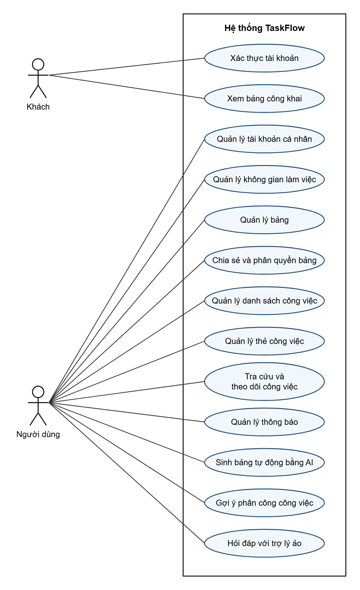

*Hình 1. Biểu đồ use case tổng quát của hệ thống TaskFlow*

*Bảng 1. Danh sách use case - tổng quát*

| Mã | Use case | Tác nhân / quan hệ | Mô tả |
|---|---|---|---|
| UC01 | Xác thực tài khoản | Khách | Đăng ký, đăng nhập (email/mật khẩu hoặc Google), xác minh email, quên và đặt lại mật khẩu, đăng xuất. |
| UC02 | Xem bảng công khai | Khách | Xem bảng ở chế độ công khai, chỉ đọc, không cần đăng nhập. |
| UC03 | Quản lý tài khoản cá nhân | Người dùng | Xem/cập nhật hồ sơ, ảnh đại diện, đổi mật khẩu, chọn giao diện sáng/tối. |
| UC04 | Quản lý không gian làm việc | Người dùng | Tạo không gian, quản lý thành viên và vai trò, xem tổng quan công việc của không gian. |
| UC05 | Quản lý bảng | Người dùng | Tạo, xem, lọc, thống kê, đổi hình nền, lưu trữ, xoá bảng; cấu hình nhãn, trường tùy chỉnh, mẫu thẻ, luật tự động và lịch tạo thẻ định kỳ. |
| UC06 | Chia sẻ và phân quyền bảng | Người dùng | Mời thành viên, liên kết mời, duyệt yêu cầu tham gia, đổi vai trò, chế độ hiển thị. |
| UC07 | Quản lý danh sách công việc | Người dùng | Thêm, đổi tên, gắn trạng thái, sắp xếp, sao chép, lưu trữ danh sách (cột). |
| UC08 | Quản lý thẻ công việc | Người dùng | Thêm, sửa, di chuyển, đổi trạng thái, lưu trữ thẻ; giao thành viên, gắn nhãn, checklist, đính kèm tệp, bình luận và nhắc tên. |
| UC09 | Tra cứu và theo dõi công việc | Người dùng | Tìm kiếm nhanh/nâng cao, xem công việc của tôi, lịch công việc, bảng điều khiển cá nhân. |
| UC10 | Quản lý thông báo | Người dùng | Nhận thông báo thời gian thực, đánh dấu đã đọc, cấu hình kênh nhận; nhắc hạn và email tổng hợp. |
| UC11 | Sinh bảng tự động bằng AI | Người dùng | Từ mô tả dự án (văn bản, DOCX, PDF) sinh kế hoạch bảng, cho chỉnh sửa rồi tạo bảng. |
| UC12 | Gợi ý phân công công việc | Người dùng | Gợi ý người phụ trách phù hợp cho thẻ và lập kế hoạch chia việc cho cả danh sách. |
| UC13 | Hỏi đáp với trợ lý ảo | Người dùng | Hỏi đáp bằng ngôn ngữ tự nhiên về tình hình công việc trong phạm vi được phép. |

> Người dùng đã đăng nhập cũng xem được bảng công khai; Khách chỉ xem được bảng có chế độ hiển thị Công khai.

> Không phải Người dùng nào cũng thực hiện được mọi thao tác trong một use case: ví dụ chỉ Quản trị viên bảng được duyệt yêu cầu tham gia, chỉ Chủ sở hữu bảng được xoá bảng. Phân quyền chi tiết xem ở biểu đồ phân rã của từng use case.

## 4. Biểu đồ use case phân rã

### 4.1. UC01 - Xác thực tài khoản

Nhóm chức năng giúp Khách tạo tài khoản và đăng nhập vào hệ thống, đồng thời giúp Người dùng bảo vệ tài khoản (xác minh email, đặt lại mật khẩu). Xác thực dùng JWT lưu trong cookie httpOnly.

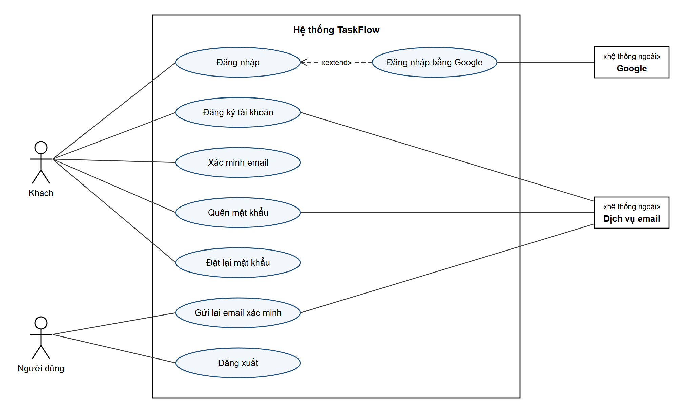

*Hình 2. Biểu đồ use case phân rã: Xác thực tài khoản*

*Bảng 2. Danh sách use case - Xác thực tài khoản*

| Mã | Use case | Tác nhân / quan hệ | Mô tả |
|---|---|---|---|
| UC01.1 | Đăng nhập | Khách | Đăng nhập bằng email và mật khẩu; thành công thì hệ thống cấp JWT lưu trong cookie httpOnly. Có giới hạn số lần thử. |
| UC01.2 | Đăng nhập bằng Google | Google; «extend» UC01.1 | Xác thực qua tài khoản Google; nếu email chưa có tài khoản thì hệ thống tự tạo tài khoản và không gian cá nhân. |
| UC01.3 | Đăng ký tài khoản | Khách, Dịch vụ email | Nhập họ tên, email, mật khẩu (tối thiểu 6 ký tự); hệ thống tạo tài khoản, tạo sẵn không gian làm việc cá nhân và gửi email xác minh. |
| UC01.4 | Xác minh email | Khách | Mở liên kết trong email để xác minh địa chỉ; mã xác minh chỉ dùng một lần và có thời hạn. Chưa xác minh vẫn dùng được hệ thống (chỉ hiện banner nhắc). |
| UC01.5 | Quên mật khẩu | Khách, Dịch vụ email | Nhập email để nhận liên kết đặt lại mật khẩu; hệ thống không tiết lộ email đó có tồn tại hay không. |
| UC01.6 | Đặt lại mật khẩu | Khách | Đặt mật khẩu mới qua liên kết trong email; mọi phiên đăng nhập cũ bị thu hồi. |
| UC01.7 | Gửi lại email xác minh | Người dùng, Dịch vụ email | Người dùng chưa xác minh yêu cầu gửi lại email xác minh từ banner nhắc. |
| UC01.8 | Đăng xuất | Người dùng | Xoá cookie phiên và ngắt kết nối thời gian thực. |

### 4.2. UC02 - Xem bảng công khai

Bảng ở chế độ Công khai có thể được xem qua đường dẫn mà không cần đăng nhập, ở chế độ chỉ đọc tuyệt đối (không kéo-thả, không bình luận); email thành viên được ẩn.

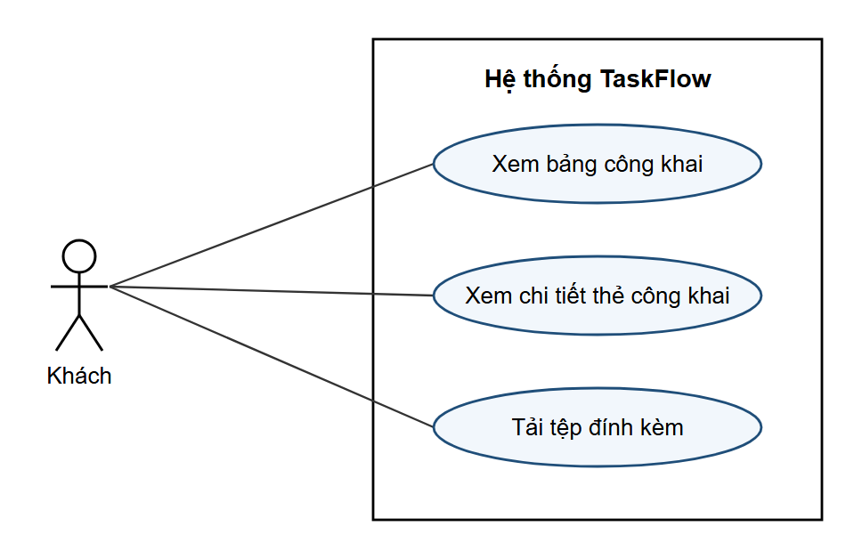

*Hình 3. Biểu đồ use case phân rã: Xem bảng công khai*

*Bảng 3. Danh sách use case - Xem bảng công khai*

| Mã | Use case | Tác nhân / quan hệ | Mô tả |
|---|---|---|---|
| UC02.1 | Xem bảng công khai | Khách | Xem các danh sách và thẻ của bảng công khai. |
| UC02.2 | Xem chi tiết thẻ công khai | Khách | Xem nhãn, ngày, thành viên, mô tả, checklist, bình luận của thẻ ở chế độ chỉ đọc. |
| UC02.3 | Tải tệp đính kèm | Khách | Tải tệp đính kèm của thẻ thuộc bảng công khai. |

> Người dùng đã đăng nhập cũng thực hiện được các use case này.

### 4.3. UC03 - Quản lý tài khoản cá nhân

Người dùng xem và cập nhật thông tin cá nhân của mình. Hồ sơ năng lực phục vụ gợi ý phân công được trình bày ở UC12.

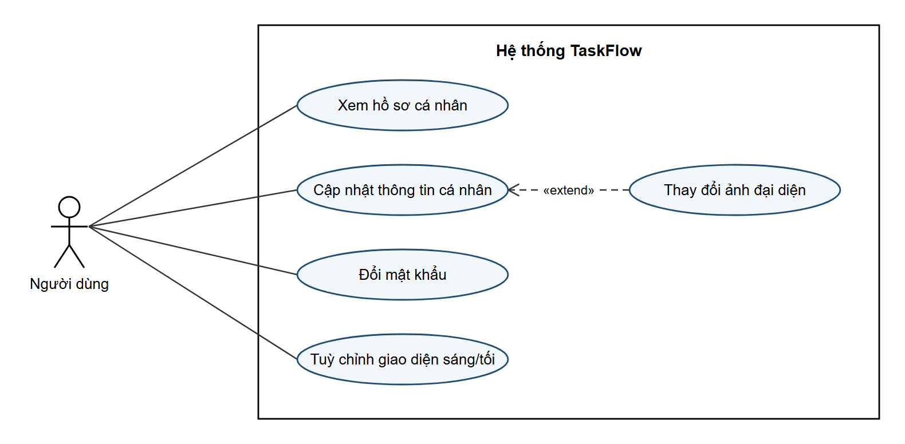

*Hình 4. Biểu đồ use case phân rã: Quản lý tài khoản cá nhân*

*Bảng 4. Danh sách use case - Quản lý tài khoản cá nhân*

| Mã | Use case | Tác nhân / quan hệ | Mô tả |
|---|---|---|---|
| UC03.1 | Xem hồ sơ cá nhân | Người dùng | Xem tên, email, ảnh đại diện, số bảng, số bảng yêu thích và ngày tham gia. |
| UC03.2 | Cập nhật thông tin cá nhân | Người dùng | Sửa tên hiển thị; email chỉ đọc. |
| UC03.3 | Thay đổi ảnh đại diện | «extend» UC03.2 | Tải ảnh lên làm ảnh đại diện hoặc gỡ ảnh hiện tại. |
| UC03.4 | Đổi mật khẩu | Người dùng | Nhập mật khẩu hiện tại và mật khẩu mới; hệ thống thu hồi các phiên và kết nối thời gian thực cũ (tokenVersion). |
| UC03.5 | Tuỳ chỉnh giao diện sáng/tối | Người dùng | Chọn chế độ Sáng, Tối hoặc Theo hệ thống. |

### 4.4. UC04 - Quản lý không gian làm việc

Mỗi bảng thuộc đúng một không gian làm việc; mỗi người dùng có sẵn một không gian cá nhân. Quyền trong không gian chia theo ba vai trò Chủ sở hữu, Quản trị viên, Thành viên.

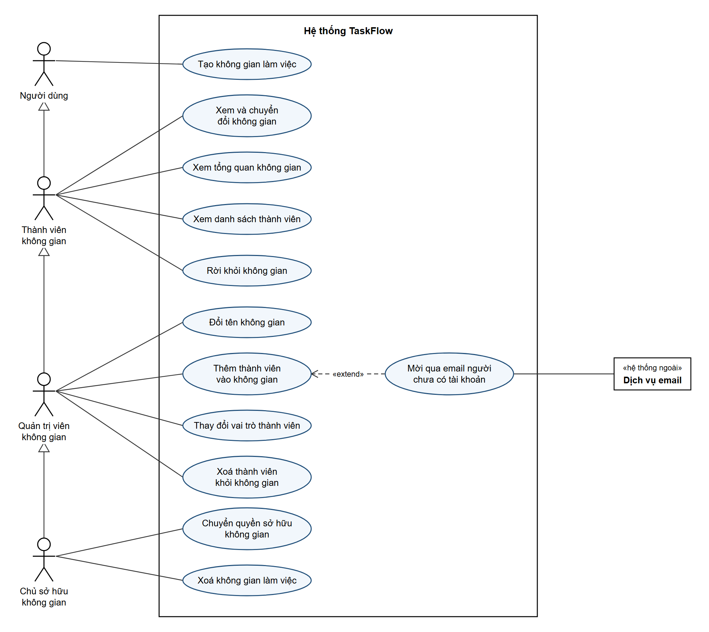

*Hình 5. Biểu đồ use case phân rã: Quản lý không gian làm việc*

*Bảng 5. Danh sách use case - Quản lý không gian làm việc*

| Mã | Use case | Tác nhân / quan hệ | Mô tả |
|---|---|---|---|
| UC04.1 | Tạo không gian làm việc | Người dùng | Tạo không gian mới; người tạo trở thành Chủ sở hữu. |
| UC04.2 | Xem và chuyển đổi không gian | Thành viên không gian | Xem danh sách không gian mình tham gia và chuyển nhanh giữa các không gian. |
| UC04.3 | Xem tổng quan không gian | Thành viên không gian | Xem số liệu thẻ (tổng, quá hạn, chưa giao, đã xong), lọc theo người phụ trách/trạng thái và các bảng trong không gian. |
| UC04.4 | Xem danh sách thành viên | Thành viên không gian | Xem các thành viên và vai trò của họ trong không gian. |
| UC04.5 | Rời khỏi không gian | Thành viên không gian | Tự rời khỏi không gian (Chủ sở hữu không rời được). |
| UC04.6 | Đổi tên không gian | Quản trị viên không gian | Đổi tên không gian làm việc. |
| UC04.7 | Thêm thành viên vào không gian | Quản trị viên không gian | Thêm người dùng đã có tài khoản theo email và chọn vai trò. |
| UC04.8 | Mời qua email người chưa có tài khoản | Dịch vụ email; «extend» UC04.7 | Nếu email chưa có tài khoản, hệ thống gửi email mời đăng ký. |
| UC04.9 | Thay đổi vai trò thành viên | Quản trị viên không gian | Đổi giữa Quản trị viên và Thành viên (không đổi được vai trò của Chủ sở hữu). |
| UC04.10 | Xoá thành viên khỏi không gian | Quản trị viên không gian | Xoá một thành viên (không xoá được Chủ sở hữu). |
| UC04.11 | Chuyển quyền sở hữu không gian | Chủ sở hữu không gian | Chuyển vai trò Chủ sở hữu cho một thành viên khác (không áp dụng cho không gian cá nhân). |
| UC04.12 | Xoá không gian làm việc | Chủ sở hữu không gian | Xoá không gian (không xoá được không gian cá nhân). |

### 4.5. UC05 - Quản lý bảng (phần 1: thao tác trên bảng)

Bảng là nơi tổ chức công việc theo các danh sách (cột) và thẻ. Quyền trên bảng phụ thuộc vai trò: Người xem bảng chỉ xem, Thành viên bảng được sửa nội dung, Chủ sở hữu bảng được lưu trữ và xoá bảng.

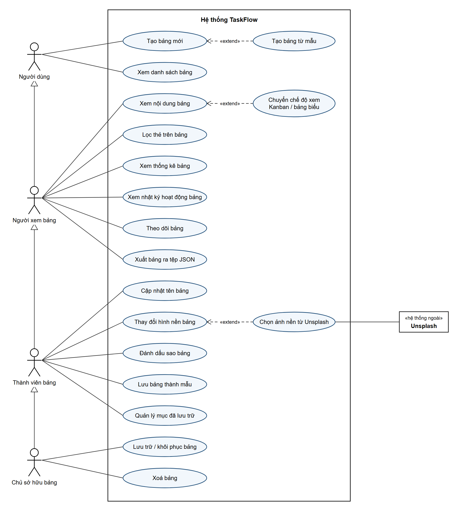

*Hình 6. Biểu đồ use case phân rã: Quản lý bảng (phần 1 - thao tác trên bảng)*

*Bảng 6. Danh sách use case - Quản lý bảng (phần 1 - thao tác trên bảng)*

| Mã | Use case | Tác nhân / quan hệ | Mô tả |
|---|---|---|---|
| UC05.1 | Tạo bảng mới | Người dùng | Đặt tên, chọn không gian làm việc và hình nền (màu hoặc ảnh Unsplash); người tạo là Chủ sở hữu bảng. |
| UC05.2 | Tạo bảng từ mẫu | «extend» UC05.1 | Dùng mẫu có sẵn của hệ thống hoặc mẫu tự lưu để dựng sẵn các cột và thẻ. |
| UC05.3 | Xem danh sách bảng | Người dùng | Xem các bảng theo nhóm: yêu thích, từng không gian làm việc, bảng đã lưu trữ. |
| UC05.4 | Xem nội dung bảng | Người xem bảng | Xem các danh sách và thẻ của bảng; cập nhật thời gian thực khi người khác thay đổi. |
| UC05.5 | Chuyển chế độ xem Kanban / bảng biểu | «extend» UC05.4 | Chuyển giữa dạng cột Kanban và dạng bảng biểu có sắp xếp theo cột. |
| UC05.6 | Lọc thẻ trên bảng | Người xem bảng | Lọc theo từ khoá, thành viên, nhãn, trạng thái, hạn (quá hạn, ngày mai, trong tuần). |
| UC05.7 | Xem thống kê bảng | Người xem bảng | Xem tổng số thẻ, số hoàn thành, quá hạn, tiến độ từng danh sách, thống kê theo trạng thái và theo thành viên. |
| UC05.8 | Xem nhật ký hoạt động bảng | Người xem bảng | Xem lịch sử thao tác trên bảng (ai, làm gì, khi nào). |
| UC05.9 | Theo dõi bảng | Người xem bảng | Bật/tắt theo dõi để nhận thông báo về thay đổi trong bảng. |
| UC05.10 | Xuất bảng ra tệp JSON | Người xem bảng | Tải toàn bộ dữ liệu bảng về máy dưới dạng tệp JSON. |
| UC05.11 | Cập nhật tên bảng | Thành viên bảng | Sửa tên bảng trực tiếp trên thanh tiêu đề. |
| UC05.12 | Thay đổi hình nền bảng | Thành viên bảng | Đổi màu nền, tải ảnh nền lên hoặc gỡ ảnh nền. |
| UC05.13 | Chọn ảnh nền từ Unsplash | Unsplash; «extend» UC05.12 | Tìm và chọn ảnh từ thư viện Unsplash (ghi nhận lượt tải theo yêu cầu của Unsplash). |
| UC05.14 | Đánh dấu sao bảng | Thành viên bảng | Đưa bảng vào mục Yêu thích để truy cập nhanh. |
| UC05.15 | Lưu bảng thành mẫu | Thành viên bảng | Lưu cấu trúc cột và thẻ của bảng thành mẫu dùng lại trong không gian. |
| UC05.16 | Quản lý mục đã lưu trữ | Thành viên bảng | Xem thẻ và danh sách đã lưu trữ; khôi phục hoặc xoá vĩnh viễn. |
| UC05.17 | Lưu trữ / khôi phục bảng | Chủ sở hữu bảng | Ẩn bảng khỏi danh sách đang dùng hoặc khôi phục lại. |
| UC05.18 | Xoá bảng | Chủ sở hữu bảng | Xoá bảng (có hộp thoại xác nhận riêng); thành viên đang mở bảng được điều hướng ra ngoài. |

> Thành viên bảng gồm vai trò MEMBER, ADMIN của bảng và thành viên không gian khi bảng ở chế độ hiển thị Không gian làm việc.

> Chủ sở hữu bảng đồng thời là Quản trị viên bảng (xem UC06). Nhóm chức năng này không có use case riêng của Quản trị viên bảng nên biểu đồ vẽ tắt Chủ sở hữu bảng kế thừa Thành viên bảng.

### 4.6. UC05 - Quản lý bảng (phần 2: cấu hình và tự động hoá)

Phần 2 của Quản lý bảng. Thành viên bảng định nghĩa các thành phần dùng chung của bảng (nhãn, trường tùy chỉnh, mẫu thẻ) và các quy tắc tự động. Bộ lập lịch của máy chủ chạy định kỳ để tạo thẻ theo lịch đã đặt.

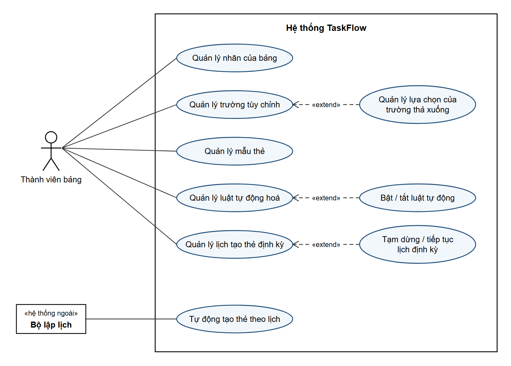

*Hình 7. Biểu đồ use case phân rã: Quản lý bảng (phần 2 - cấu hình và tự động hoá)*

*Bảng 7. Danh sách use case - Quản lý bảng (phần 2 - cấu hình và tự động hoá)*

| Mã | Use case | Tác nhân / quan hệ | Mô tả |
|---|---|---|---|
| UC05.19 | Quản lý nhãn của bảng | Thành viên bảng | Thêm, sửa tên/màu, xoá nhãn (bảng 10 màu dùng chung). |
| UC05.20 | Quản lý trường tùy chỉnh | Thành viên bảng | Thêm, đổi tên, xoá trường kiểu Văn bản, Số, Ngày, Hộp kiểm, Danh sách thả xuống. |
| UC05.21 | Quản lý lựa chọn của trường thả xuống | «extend» UC05.20 | Thêm, sửa, xoá các lựa chọn của trường kiểu danh sách thả xuống. |
| UC05.22 | Quản lý mẫu thẻ | Thành viên bảng | Tạo và xoá mẫu thẻ của bảng. |
| UC05.23 | Quản lý luật tự động hoá | Thành viên bảng | Tạo luật: điều kiện (thẻ được tạo / thẻ được chuyển vào danh sách X) và tối đa 5 hành động (đánh dấu xong, gắn nhãn, giao thành viên); sửa, xoá luật. |
| UC05.24 | Bật / tắt luật tự động | «extend» UC05.23 | Tạm ngưng hoặc kích hoạt lại một luật. |
| UC05.25 | Quản lý lịch tạo thẻ định kỳ | Thành viên bảng | Đặt lịch cho một danh sách: tần suất ngày/tuần/tháng, giờ tạo, mẫu thẻ, ngày dừng; xoá lịch. |
| UC05.26 | Tạm dừng / tiếp tục lịch định kỳ | «extend» UC05.25 | Tạm dừng hoặc tiếp tục một lịch tạo thẻ. |
| UC05.27 | Tự động tạo thẻ theo lịch | Bộ lập lịch | Đến giờ, hệ thống tạo thẻ mới vào danh sách theo lịch (dùng mẫu thẻ nếu có). |

### 4.7. UC06 - Chia sẻ và phân quyền bảng

Bảng có bốn vai trò: Chủ sở hữu, Quản trị viên, Thành viên, Người xem. Quản trị viên bảng gồm vai trò ADMIN, Chủ sở hữu bảng và Chủ sở hữu/Quản trị viên của không gian chứa bảng.

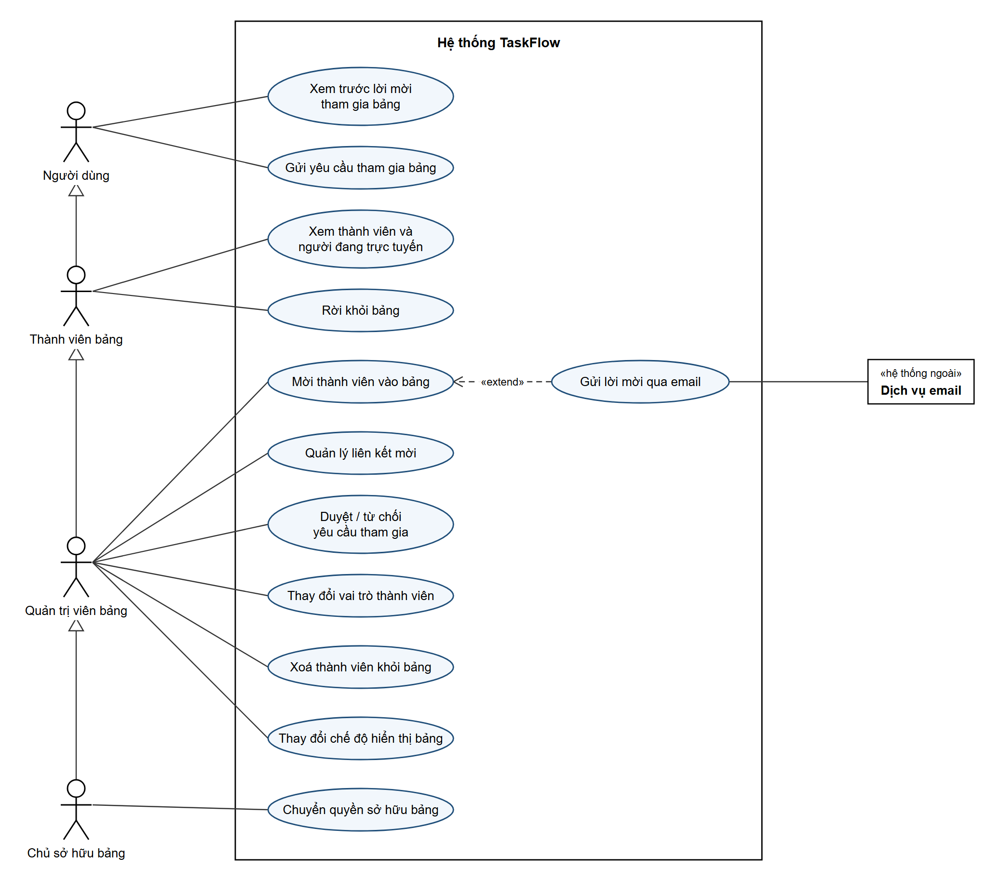

*Hình 8. Biểu đồ use case phân rã: Chia sẻ và phân quyền bảng*

*Bảng 8. Danh sách use case - Chia sẻ và phân quyền bảng*

| Mã | Use case | Tác nhân / quan hệ | Mô tả |
|---|---|---|---|
| UC06.1 | Xem trước lời mời tham gia bảng | Người dùng | Mở liên kết mời để xem tên và hình nền bảng trước khi tham gia. |
| UC06.2 | Gửi yêu cầu tham gia bảng | Người dùng | Gửi yêu cầu tham gia; Quản trị viên bảng nhận thông báo thời gian thực để duyệt. |
| UC06.3 | Xem thành viên và người đang trực tuyến | Thành viên bảng | Xem danh sách thành viên, vai trò và ai đang mở bảng. |
| UC06.4 | Rời khỏi bảng | Thành viên bảng | Tự rời khỏi bảng (Chủ sở hữu không rời được). |
| UC06.5 | Mời thành viên vào bảng | Quản trị viên bảng | Mời theo email và chọn vai trò (Quản trị viên, Thành viên, Người xem). |
| UC06.6 | Gửi lời mời qua email | Dịch vụ email; «extend» UC06.5 | Nếu email chưa có tài khoản, hệ thống gửi email kèm liên kết tham gia. |
| UC06.7 | Quản lý liên kết mời | Quản trị viên bảng | Tạo, sao chép hoặc vô hiệu hoá liên kết mời tham gia bảng. |
| UC06.8 | Duyệt / từ chối yêu cầu tham gia | Quản trị viên bảng | Chấp nhận hoặc từ chối các yêu cầu tham gia đang chờ. |
| UC06.9 | Thay đổi vai trò thành viên | Quản trị viên bảng | Đổi vai trò của thành viên trong bảng. |
| UC06.10 | Xoá thành viên khỏi bảng | Quản trị viên bảng | Xoá thành viên; người bị xoá mất quyền truy cập ngay, kể cả kết nối thời gian thực. |
| UC06.11 | Thay đổi chế độ hiển thị bảng | Quản trị viên bảng | Chọn Riêng tư, Không gian làm việc hoặc Công khai (chỉ đọc). |
| UC06.12 | Chuyển quyền sở hữu bảng | Chủ sở hữu bảng | Chuyển vai trò Chủ sở hữu cho một thành viên khác của bảng. |

> Biểu đồ lược bỏ Người xem bảng: Thành viên bảng kế thừa Người xem bảng (xem UC05), Người xem bảng kế thừa Người dùng. Người xem bảng cũng xem được thành viên và tự rời khỏi bảng.

### 4.8. UC07 - Quản lý danh sách công việc

Danh sách là một cột trên bảng Kanban. Mỗi danh sách có thể gắn một trạng thái công việc (Chưa làm, Đang làm, Chờ duyệt, Hoàn thành, Bị chặn); thẻ nằm trong cột nào sẽ mang trạng thái của cột đó.

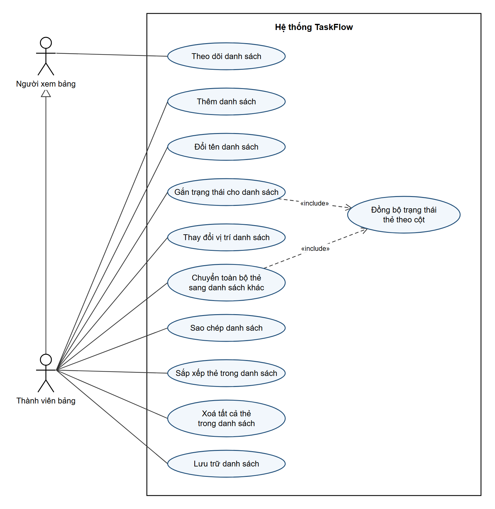

*Hình 9. Biểu đồ use case phân rã: Quản lý danh sách công việc*

*Bảng 9. Danh sách use case - Quản lý danh sách công việc*

| Mã | Use case | Tác nhân / quan hệ | Mô tả |
|---|---|---|---|
| UC07.1 | Theo dõi danh sách | Người xem bảng | Bật/tắt theo dõi để nhận thông báo về thẻ trong danh sách. |
| UC07.2 | Thêm danh sách | Thành viên bảng | Thêm cột mới vào cuối bảng; hệ thống đoán trạng thái theo tên cột nếu người dùng không chọn. |
| UC07.3 | Đổi tên danh sách | Thành viên bảng | Sửa tên cột. |
| UC07.4 | Gắn trạng thái cho danh sách | Thành viên bảng; «include» UC07.5 | Chọn trạng thái cho cột hoặc để cột tự do. |
| UC07.5 | Đồng bộ trạng thái thẻ theo cột | được UC07.4, UC07.7 bao hàm («include») | Cập nhật trạng thái của mọi thẻ trong cột theo trạng thái của cột. |
| UC07.6 | Thay đổi vị trí danh sách | Thành viên bảng | Kéo-thả cột hoặc chuyển cột lên đầu/cuối bảng. |
| UC07.7 | Chuyển toàn bộ thẻ sang danh sách khác | Thành viên bảng; «include» UC07.5 | Chuyển tất cả thẻ của cột sang cột khác trong bảng. |
| UC07.8 | Sao chép danh sách | Thành viên bảng | Tạo bản sao của cột cùng các thẻ trong cột. |
| UC07.9 | Sắp xếp thẻ trong danh sách | Thành viên bảng | Sắp xếp theo ngày tạo (mới/cũ), theo tên hoặc đưa thẻ đã xong xuống cuối. |
| UC07.10 | Xoá tất cả thẻ trong danh sách | Thành viên bảng | Xoá mọi thẻ trong cột (có xác nhận). |
| UC07.11 | Lưu trữ danh sách | Thành viên bảng | Ẩn cột khỏi bảng; khôi phục hoặc xoá vĩnh viễn ở mục lưu trữ (UC05.16). |

### 4.9. UC08 - Quản lý thẻ công việc (phần 1: thao tác trên thẻ)

Thẻ là một công việc cụ thể, gồm tiêu đề, mô tả, ngày bắt đầu, hạn hoàn thành, trạng thái và ảnh bìa. Trạng thái thẻ và cột chứa thẻ được giữ đồng bộ hai chiều.

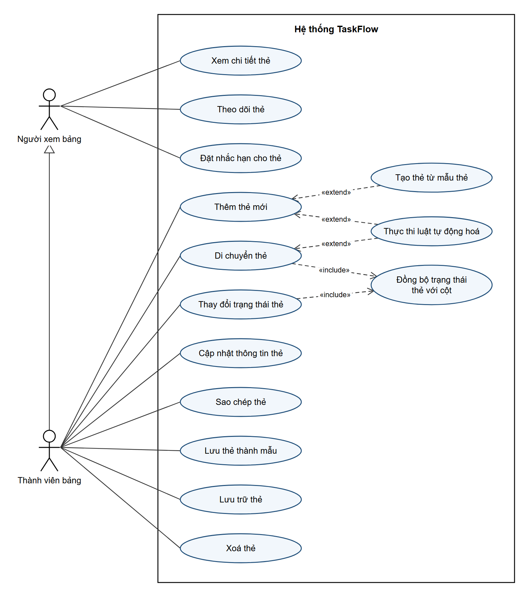

*Hình 10. Biểu đồ use case phân rã: Quản lý thẻ công việc (phần 1 - thao tác trên thẻ)*

*Bảng 10. Danh sách use case - Quản lý thẻ công việc (phần 1 - thao tác trên thẻ)*

| Mã | Use case | Tác nhân / quan hệ | Mô tả |
|---|---|---|---|
| UC08.1 | Xem chi tiết thẻ | Người xem bảng | Mở cửa sổ chi tiết thẻ: thông tin, checklist, tệp, bình luận và lịch sử hoạt động. |
| UC08.2 | Theo dõi thẻ | Người xem bảng | Bật/tắt theo dõi để nhận thông báo khi thẻ thay đổi. |
| UC08.3 | Đặt nhắc hạn cho thẻ | Người xem bảng | Chọn các mốc nhắc trước hạn (riêng cho từng người). |
| UC08.4 | Thêm thẻ mới | Thành viên bảng | Thêm thẻ vào cuối một danh sách; thẻ nhận trạng thái của danh sách. |
| UC08.5 | Tạo thẻ từ mẫu thẻ | «extend» UC08.4 | Tạo thẻ theo mẫu thẻ đã lưu (kèm mô tả, checklist). |
| UC08.6 | Di chuyển thẻ | Thành viên bảng; «include» UC08.9 | Kéo-thả thẻ trong/giữa các cột, hoặc chuyển sang bảng khác. |
| UC08.7 | Thực thi luật tự động hoá | «extend» UC08.4, UC08.6 | Khi có luật khớp (thẻ được tạo / được chuyển vào cột X), hệ thống tự đánh dấu xong, gắn nhãn hoặc giao thành viên. |
| UC08.8 | Thay đổi trạng thái thẻ | Thành viên bảng; «include» UC08.9 | Đổi trạng thái hoặc đánh dấu hoàn thành; thẻ tự chuyển sang cột mang trạng thái đó (nếu có). |
| UC08.9 | Đồng bộ trạng thái thẻ với cột | được UC08.6, UC08.8 bao hàm («include») | Giữ trạng thái thẻ khớp với trạng thái của cột chứa thẻ. |
| UC08.10 | Cập nhật thông tin thẻ | Thành viên bảng | Sửa tiêu đề, mô tả (Markdown), ngày bắt đầu, hạn hoàn thành, ảnh bìa. |
| UC08.11 | Sao chép thẻ | Thành viên bảng | Tạo bản sao của thẻ trong danh sách được chọn. |
| UC08.12 | Lưu thẻ thành mẫu | Thành viên bảng | Lưu thẻ làm mẫu thẻ dùng lại trong bảng. |
| UC08.13 | Lưu trữ thẻ | Thành viên bảng | Ẩn thẻ khỏi bảng; khôi phục hoặc xoá vĩnh viễn ở mục lưu trữ. |
| UC08.14 | Xoá thẻ | Thành viên bảng | Xoá thẻ khỏi bảng. |

### 4.10. UC08 - Quản lý thẻ công việc (phần 2: cộng tác trên thẻ)

Phần 2 của Quản lý thẻ công việc. Các thao tác cộng tác diễn ra trong cửa sổ chi tiết thẻ. Mọi thay đổi được ghi vào lịch sử hoạt động và đồng bộ thời gian thực tới những người đang mở bảng.

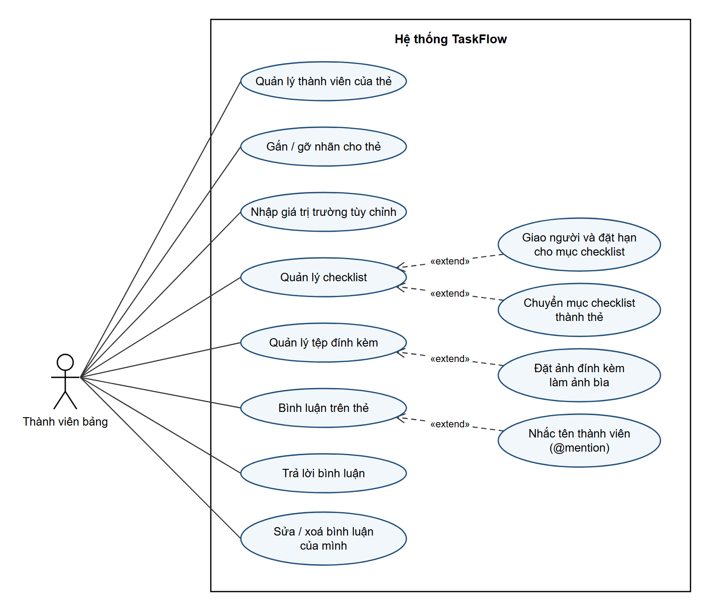

*Hình 11. Biểu đồ use case phân rã: Quản lý thẻ công việc (phần 2 - cộng tác trên thẻ)*

*Bảng 11. Danh sách use case - Quản lý thẻ công việc (phần 2 - cộng tác trên thẻ)*

| Mã | Use case | Tác nhân / quan hệ | Mô tả |
|---|---|---|---|
| UC08.15 | Quản lý thành viên của thẻ | Thành viên bảng | Giao hoặc gỡ người phụ trách (một thẻ có thể có nhiều người); người được giao nhận thông báo. |
| UC08.16 | Gắn / gỡ nhãn cho thẻ | Thành viên bảng | Chọn nhãn màu của bảng cho thẻ; có thể tạo nhãn mới ngay tại đây. |
| UC08.17 | Nhập giá trị trường tùy chỉnh | Thành viên bảng | Nhập giá trị cho các trường do bảng định nghĩa (văn bản, số, ngày, hộp kiểm, danh sách thả xuống). |
| UC08.18 | Quản lý checklist | Thành viên bảng | Thêm/xoá checklist, thêm/sửa/xoá/đánh dấu mục, kéo-thả sắp xếp mục; xem phần trăm hoàn thành. |
| UC08.19 | Giao người và đặt hạn cho mục checklist | «extend» UC08.18 | Chỉ định người thực hiện và hạn riêng cho từng mục. |
| UC08.20 | Chuyển mục checklist thành thẻ | «extend» UC08.18 | Tách một mục checklist thành thẻ mới trong cùng danh sách. |
| UC08.21 | Quản lý tệp đính kèm | Thành viên bảng | Tải tệp lên thẻ, xem trước ảnh, tải về, xoá tệp; quyền tải tệp được kiểm tra theo quyền xem bảng. |
| UC08.22 | Đặt ảnh đính kèm làm ảnh bìa | «extend» UC08.21 | Chọn một ảnh đính kèm làm ảnh bìa của thẻ. |
| UC08.23 | Bình luận trên thẻ | Thành viên bảng | Viết bình luận; thành viên của thẻ và người đang theo dõi thẻ/danh sách/bảng nhận thông báo. |
| UC08.24 | Nhắc tên thành viên (@mention) | «extend» UC08.23 | Gõ @ để chọn thành viên; người được nhắc nhận thông báo. |
| UC08.25 | Trả lời bình luận | Thành viên bảng | Trả lời một bình luận (luồng một cấp); tác giả bình luận gốc nhận thông báo. Xoá bình luận gốc vẫn giữ các trả lời. |
| UC08.26 | Sửa / xoá bình luận của mình | Thành viên bảng | Chỉ tác giả được sửa hoặc xoá bình luận của mình. |

### 4.11. UC09 - Tra cứu và theo dõi công việc

Các chức năng giúp người dùng nắm được công việc của mình trên mọi bảng mà họ có quyền xem.

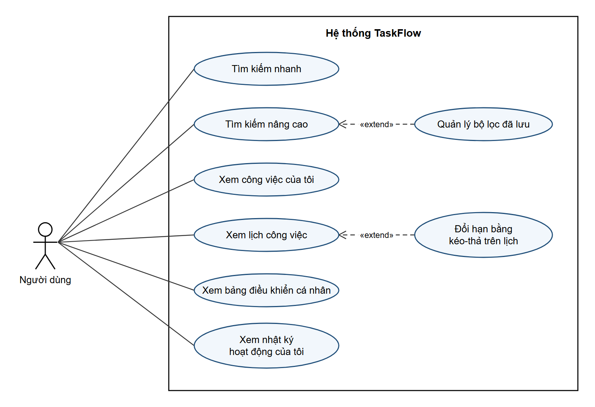

*Hình 12. Biểu đồ use case phân rã: Tra cứu và theo dõi công việc*

*Bảng 12. Danh sách use case - Tra cứu và theo dõi công việc*

| Mã | Use case | Tác nhân / quan hệ | Mô tả |
|---|---|---|---|
| UC09.1 | Tìm kiếm nhanh | Người dùng | Gõ từ khoá trên thanh tiêu đề để tìm bảng và thẻ (phím tắt /). |
| UC09.2 | Tìm kiếm nâng cao | Người dùng | Lọc thẻ xuyên bảng theo từ khoá, người phụ trách, trạng thái, nhãn, quá hạn, khoảng ngày hết hạn; có phân trang. |
| UC09.3 | Quản lý bộ lọc đã lưu | «extend» UC09.2 | Lưu bộ lọc hiện tại, áp dụng lại hoặc xoá bộ lọc đã lưu. |
| UC09.4 | Xem công việc của tôi | Người dùng | Xem các thẻ được giao cho mình, nhóm theo hạn (quá hạn, hôm nay, trong tuần, sau này, không có hạn). |
| UC09.5 | Xem lịch công việc | Người dùng | Xem thẻ và mục checklist có hạn theo tháng hoặc tuần. |
| UC09.6 | Đổi hạn bằng kéo-thả trên lịch | «extend» UC09.5 | Kéo thẻ sang ngày khác để đổi hạn (cần quyền sửa bảng chứa thẻ). |
| UC09.7 | Xem bảng điều khiển cá nhân | Người dùng | Xem số bảng, số thẻ được giao, quá hạn, đến hạn trong tuần, mục cần chú ý, truy cập nhanh. |
| UC09.8 | Xem nhật ký hoạt động của tôi | Người dùng | Xem các thao tác mình đã thực hiện, có liên kết tới bảng liên quan. |

### 4.12. UC10 - Quản lý thông báo

Thông báo được tạo khi có sự kiện liên quan tới người dùng (được giao thẻ, được nhắc tên, bình luận, thay đổi thành viên, yêu cầu tham gia...). Bộ lập lịch của máy chủ chạy định kỳ để gửi nhắc hạn và email tổng hợp.

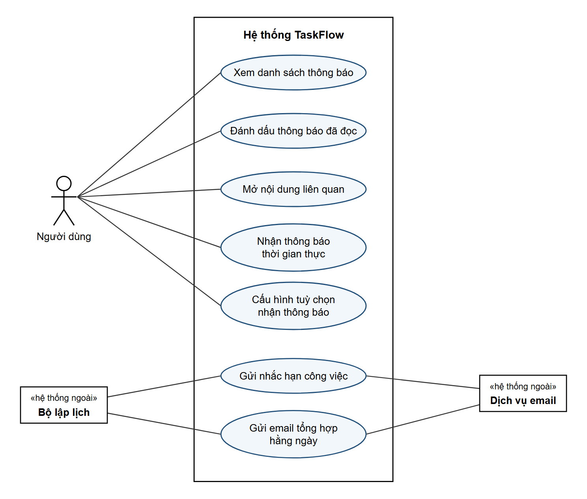

*Hình 13. Biểu đồ use case phân rã: Quản lý thông báo*

*Bảng 13. Danh sách use case - Quản lý thông báo*

| Mã | Use case | Tác nhân / quan hệ | Mô tả |
|---|---|---|---|
| UC10.1 | Xem danh sách thông báo | Người dùng | Mở chuông thông báo xem danh sách, có thể chỉ hiện thông báo chưa đọc. |
| UC10.2 | Đánh dấu thông báo đã đọc | Người dùng | Đánh dấu một thông báo hoặc tất cả là đã đọc. |
| UC10.3 | Mở nội dung liên quan | Người dùng | Bấm vào thông báo để đi tới đúng thẻ, bảng hoặc không gian liên quan. |
| UC10.4 | Nhận thông báo thời gian thực | Người dùng | Thông báo mới được đẩy ngay qua Socket.IO, số chưa đọc cập nhật tức thì. |
| UC10.5 | Cấu hình tuỳ chọn nhận thông báo | Người dùng | Bật/tắt từng nhóm thông báo trong ứng dụng, email nhắc hạn và email tổng hợp hằng ngày. |
| UC10.6 | Gửi nhắc hạn công việc | Bộ lập lịch, Dịch vụ email | Đến mốc nhắc trước hạn, hệ thống tạo thông báo và gửi email nhắc (nếu người dùng bật). |
| UC10.7 | Gửi email tổng hợp hằng ngày | Bộ lập lịch, Dịch vụ email | Mỗi 24 giờ gom các thông báo trong ngày gửi thành một email cho người đã bật tuỳ chọn. |

### 4.13. UC11 - Sinh bảng tự động bằng AI

Người dùng mô tả dự án, hệ thống đề xuất kế hoạch gồm các danh sách và thẻ (kèm hạn). Bộ luật luôn chạy; mô hình ngôn ngữ lớn chỉ được gọi khi đã cấu hình, nếu lỗi thì kế hoạch vẫn được tạo bằng bộ luật.

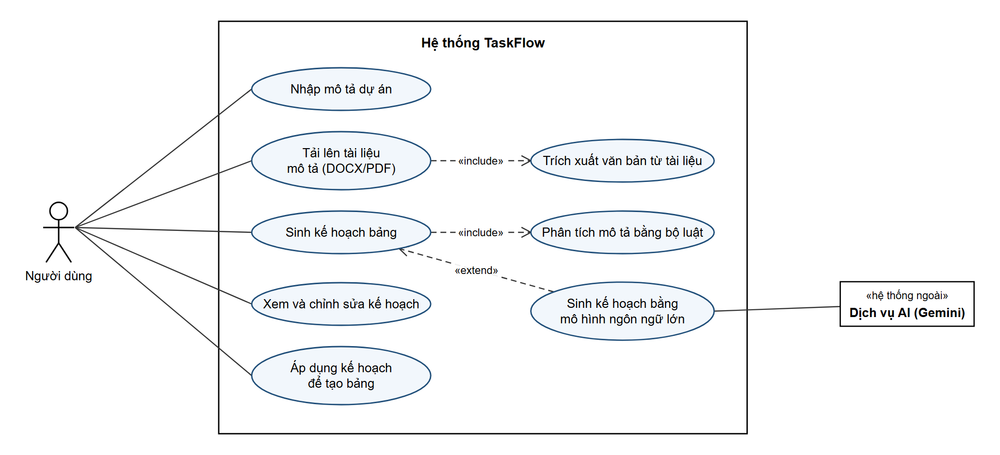

*Hình 14. Biểu đồ use case phân rã: Sinh bảng tự động bằng AI*

*Bảng 14. Danh sách use case - Sinh bảng tự động bằng AI*

| Mã | Use case | Tác nhân / quan hệ | Mô tả |
|---|---|---|---|
| UC11.1 | Nhập mô tả dự án | Người dùng | Nhập văn bản mô tả dự án, chọn không gian làm việc và khoảng thời gian thực hiện. |
| UC11.2 | Tải lên tài liệu mô tả (DOCX/PDF) | Người dùng; «include» UC11.3 | Tải tệp DOCX hoặc PDF thay cho việc gõ mô tả; hệ thống dùng thẳng nội dung tệp, người dùng không cần gõ lại. |
| UC11.3 | Trích xuất văn bản từ tài liệu | được UC11.2 bao hàm («include») | Máy chủ đọc phần chữ trong tệp (tối đa 20 000 ký tự) và dùng làm đầu vào cho bước sinh kế hoạch. |
| UC11.4 | Sinh kế hoạch bảng | Người dùng; «include» UC11.5 | Hệ thống phân tích mô tả và đề xuất danh sách, thẻ, ngày hạn kèm các cảnh báo cần kiểm tra. |
| UC11.5 | Phân tích mô tả bằng bộ luật | được UC11.4 bao hàm («include») | Nhận diện tiêu đề, gạch đầu dòng, ngày tháng, tên thành viên để dựng kế hoạch. |
| UC11.6 | Sinh kế hoạch bằng mô hình ngôn ngữ lớn | Dịch vụ AI (Gemini); «extend» UC11.4 | Khi đã cấu hình khoá API, gọi Gemini để hiểu mô tả dạng văn xuôi; kết quả được kiểm tra theo lược đồ JSON. |
| UC11.7 | Xem và chỉnh sửa kế hoạch | Người dùng | Sửa tên danh sách, thẻ, ngày; bỏ chọn thẻ không cần; xem các cảnh báo. |
| UC11.8 | Áp dụng kế hoạch để tạo bảng | Người dùng | Tạo bảng mới gồm các danh sách và thẻ đã chọn; mỗi kế hoạch chỉ áp dụng được một lần. |

### 4.14. UC12 - Gợi ý phân công công việc

Hệ thống xếp hạng người phù hợp để nhận thẻ dựa trên bốn thành phần: kinh nghiệm (độ tương đồng nội dung thẻ cũ), độ tin cậy (tỉ lệ đúng hạn), khả dụng (khối lượng đang làm) và hồ sơ tự khai. Trọng số được học từ lựa chọn thực tế của người dùng. Gợi ý chỉ là đề xuất, việc giao thẻ luôn do con người quyết định.

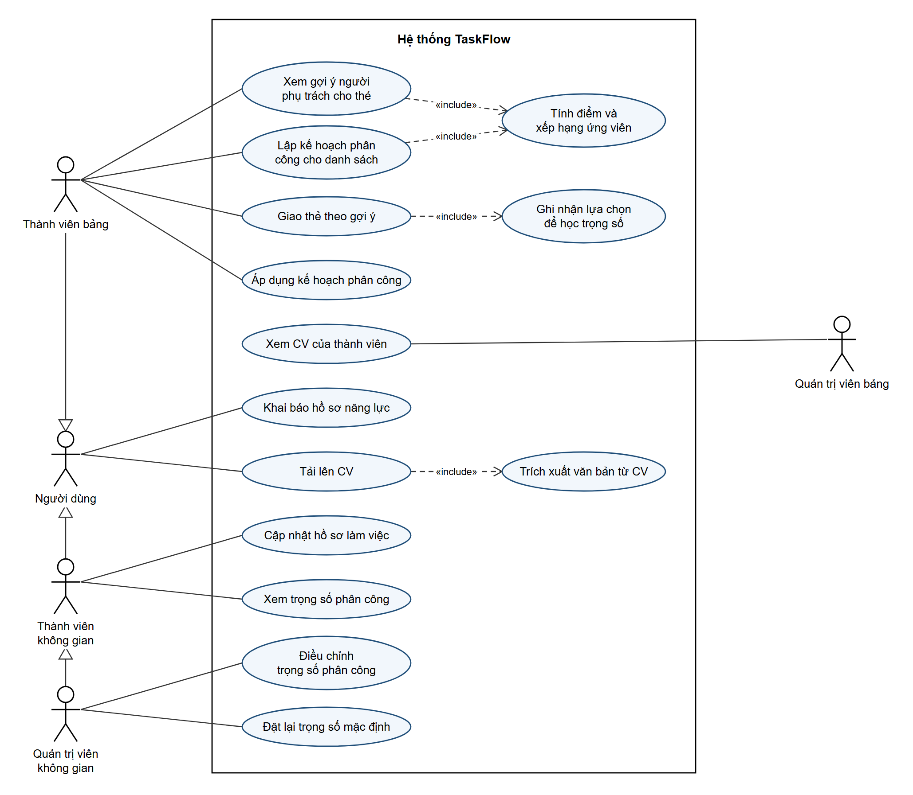

*Hình 15. Biểu đồ use case phân rã: Gợi ý phân công công việc*

*Bảng 15. Danh sách use case - Gợi ý phân công công việc*

| Mã | Use case | Tác nhân / quan hệ | Mô tả |
|---|---|---|---|
| UC12.1 | Xem gợi ý người phụ trách cho thẻ | Thành viên bảng; «include» UC12.3 | Xem danh sách người phù hợp nhất kèm điểm từng thành phần, cảnh báo (quá tải, tạm nghỉ) và bằng chứng. |
| UC12.2 | Lập kế hoạch phân công cho danh sách | Thành viên bảng; «include» UC12.3 | Chia các thẻ chưa có người nhận của một danh sách cho các thành viên (chỉ xem trước). |
| UC12.3 | Tính điểm và xếp hạng ứng viên | được UC12.1, UC12.2 bao hàm («include») | Tính bốn thành phần điểm cho từng ứng viên rồi tổng hợp theo trọng số của không gian. |
| UC12.4 | Giao thẻ theo gợi ý | Thành viên bảng; «include» UC12.6 | Chọn một người trong danh sách gợi ý để giao thẻ. |
| UC12.5 | Áp dụng kế hoạch phân công | Thành viên bảng | Đổi người hoặc bỏ chọn từng thẻ rồi áp dụng; hệ thống giao các thẻ đã chọn. |
| UC12.6 | Ghi nhận lựa chọn để học trọng số | được UC12.4 bao hàm («include») | Lưu người thực sự được chọn; khi đủ số lượt phản hồi, hệ thống điều chỉnh trọng số của không gian. |
| UC12.7 | Xem CV của thành viên | Quản trị viên bảng | Chủ hoặc quản trị viên của một bảng có người đó (hoặc của không gian chứa bảng) tải CV để tham khảo khi giao việc; chỉ xem được khi chủ CV bật dùng hồ sơ cho gợi ý. |
| UC12.8 | Khai báo hồ sơ năng lực | Người dùng | Tự khai kỹ năng, công việc đã làm; bật/tắt việc dùng hồ sơ cho gợi ý. |
| UC12.9 | Tải lên CV | Người dùng; «include» UC12.10 | Tải CV dạng PDF/DOCX (tối đa 5 MB) để gợi ý dùng thẳng nội dung tệp; có thể thay hoặc xoá CV. |
| UC12.10 | Trích xuất văn bản từ CV | được UC12.9 bao hàm («include») | Máy chủ đọc chữ trong CV (không gọi AI) và lưu lại để so khớp khi gợi ý; muốn đổi nội dung thì thay tệp CV. |
| UC12.11 | Cập nhật hồ sơ làm việc | Thành viên không gian | Đặt số thẻ làm song song tối đa (1-30) và thời gian tạm nghỉ của chính mình trong không gian. |
| UC12.12 | Xem trọng số phân công | Thành viên không gian | Xem trọng số đang dùng, lịch sử thay đổi và số liệu phản hồi. |
| UC12.13 | Điều chỉnh trọng số phân công | Quản trị viên không gian | Đặt bốn trọng số (mỗi số trong khoảng 0,05-0,70, tổng bằng 1). |
| UC12.14 | Đặt lại trọng số mặc định | Quản trị viên không gian | Đưa trọng số về mặc định và đặt lại bộ đếm phản hồi. |

> Quản trị viên bảng cũng là Thành viên bảng (xem UC06); tác nhân này được đặt bên phải để các đường nối không cắt nhau.

### 4.15. UC13 - Hỏi đáp với trợ lý ảo

Trợ lý ảo trả lời câu hỏi bằng tiếng Việt về tình hình công việc (thẻ quá hạn, tiến độ, khối lượng của thành viên, danh mục bảng/không gian, lịch sử thay đổi...). Đây là chức năng tiện ích của sản phẩm, không thuộc hai cơ chế nghiên cứu của khóa luận. Câu trả lời chỉ dùng dữ liệu trong phạm vi người dùng có quyền xem.

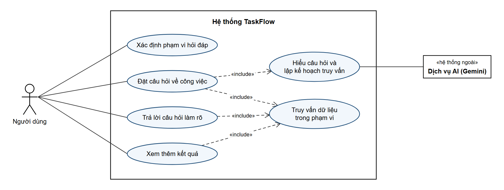

*Hình 16. Biểu đồ use case phân rã: Hỏi đáp với trợ lý ảo*

*Bảng 16. Danh sách use case - Hỏi đáp với trợ lý ảo*

| Mã | Use case | Tác nhân / quan hệ | Mô tả |
|---|---|---|---|
| UC13.1 | Xác định phạm vi hỏi đáp | Người dùng | Phạm vi mặc định theo trang đang mở (công việc của tôi, một không gian hoặc một bảng); có thể nêu rõ tên bảng hay không gian ngay trong câu hỏi. |
| UC13.2 | Đặt câu hỏi về công việc | Người dùng; «include» UC13.3, UC13.4 | Gõ câu hỏi bằng ngôn ngữ tự nhiên; có thể hỏi tiếp dựa trên ngữ cảnh câu trước. |
| UC13.3 | Hiểu câu hỏi và lập kế hoạch truy vấn | Dịch vụ AI (Gemini); được UC13.2 bao hàm («include») | Mô hình ngôn ngữ xác định ý định, khoảng thời gian, đối tượng được hỏi và chọn công cụ truy vấn phù hợp. |
| UC13.4 | Truy vấn dữ liệu trong phạm vi | được UC13.2, UC13.5, UC13.6 bao hàm («include») | Các công cụ truy vấn do máy chủ thực thi đếm, liệt kê, thống kê thẻ và nhật ký; quyền được kiểm tra lại ở mỗi lượt. |
| UC13.5 | Trả lời câu hỏi làm rõ | Người dùng; «include» UC13.4 | Khi câu hỏi mơ hồ (trùng tên người, chưa rõ không gian), người dùng chọn một phương án. |
| UC13.6 | Xem thêm kết quả | Người dùng; «include» UC13.4 | Xem trang tiếp theo của danh sách kết quả. |
